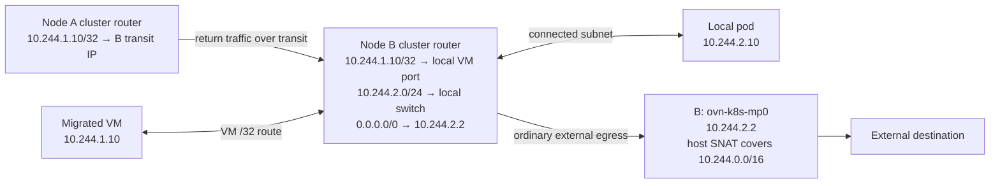

# Gateway Modes

OVN-Kubernetes supports two gateway modes that control how north-south
(pod ↔ external) traffic leaves the cluster at each node. The mode is
set cluster-wide via `--gateway-mode`.

## Shared Gateway Mode (`shared`)

In shared gateway mode the node's external IP address is **shared**
between the host and OVN. Pod egress traffic is routed entirely through
OVN — the Gateway Router (GR) performs SNAT to the node IP and sends
packets directly out the physical uplink via the external bridge
(br-ex). The host kernel is not in the egress data path.

This is the default mode in standard OVN-Kubernetes deployments/manifests.
At the binary CLI level, omitting `--gateway-mode` leaves gateway functionality disabled.

## Local Gateway Mode (`local`)

In local gateway mode (default network), pod egress traffic exits the OVN br-int bridge
but is delivered to the **host kernel** (via the management port, ovn-k8s-mp0) instead
of going directly to the physical NIC. The host's routing table and
iptables/nftables masquerading handle the final hop out. This gives the
host full control over outbound path selection.

Note: For some no-overlay CUDN paths, OVN network-scoped router SNAT-exemption/NAT
objects also participate, so the exact SNAT mechanism is network-type dependent.

## Pod Egress Routing on the Cluster Router

Layer 3 networks use a destination default route per IP family across Geneve,
no-overlay and EVPN transports (EVPN supports local gateway mode only). Shared
gateway mode points it at the local gateway router; local gateway mode points it
at the local management port:

```text
0.0.0.0/0  dst-ip  100.64.0.2   # shared, via GR_<node>
0.0.0.0/0  dst-ip  10.244.1.2   # local, via ovn-k8s-mp0
```

Gateway reconciliation replaces the old node-subnet and aggregate cluster-subnet
source routes atomically with the defaults. Geneve networks also use the fallback
logical router policies below. No-overlay and L3 EVPN use the default for remote
pod traffic as well, with the GR or host VRF providing onward routing. EgressIP,
EgressService and KubeVirt do not create aggregate source routes.

The following policy chains apply only to L3 Geneve networks; EgressIP and
EgressService are unsupported on no-overlay and EVPN networks.

Packets begin policy lookup in the main chain. A `jump` selects a named chain
and restarts lookup there. Priorities order rules within the active chain;
an `allow` or `reroute` action completes the policy decision. An `allow` preserves
the route or multicast output group selected by the preceding routing stage.

### Main Chain

The following main-chain policies control feature exemptions and egress selection;
other cluster-router policies are omitted from this table.

| Priority | Match | Action |
|---|---|---|
| 102 | Pod-to-pod or pod-to-join exemption | Allow normal routing |
| 102 | EgressIP reply-traffic exemption | Jump to `default-egress`, bypassing feature reroutes |
| 102 | EgressIP/EgressService pod-to-node exemption | Jump to `default-egress-node`, bypassing feature reroutes |
| 101 | EgressService-selected traffic | Reroute to the EgressService next hop |
| 100 | EgressIP-selected traffic | Reroute to the EgressIP next hop(s) |
| 90 | Remaining IP traffic | Jump to `default-egress` |

### `default-egress` Chain

These rules become eligible only after a jump selects `default-egress`. Their
higher priorities do not override the main-chain EgressIP or EgressService rules.
For example, external traffic selected only by EgressIP matches main-chain
priority 100 and completes its policy decision without entering this chain.

| Priority | Match | Action |
|---|---|---|
| 140 | Multicast, or destination in this network's cluster, join or transit subnets | Preserve destination route or multicast output group |
| 130 | Traffic enters from the local node switch | Allow destination routing, including the mode's default |
| 120 | Source in this network's cluster subnets | Reroute to the local GR |
| 110 | Everything else | Allow destination routing |

### `default-egress-node` Chain

Node-connection exemptions jump to this separate chain. It makes the same routing
decisions as `default-egress`, but each terminal action also sets packet mark
1008. OVN does not apply that mark option on a jump itself.

| Priority | Match | Action |
|---|---|---|
| 140 | Multicast, or destination in this network's cluster, join or transit subnets | Preserve destination route or multicast output group; set mark 1008 |
| 130 | Traffic enters from the local node switch | Allow destination routing, including the mode's default; set mark 1008 |
| 120 | Source in this network's cluster subnets | Reroute to the local GR; set mark 1008 |
| 110 | Everything else | Allow destination routing; set mark 1008 |

Both named chains use priorities above 100 as a compatibility workaround for OVN
versions that omit chain checks on ECMP policy flows. On those versions, a
main-chain EgressIP ECMP policy can incorrectly match again after a jump. The
higher-priority rules in the selected chain win over that ECMP policy. The
terminal allow also uses priority 110 to protect exempt traffic during gateway
initialization. Main-chain priorities remain unchanged.

### Local and Migrated Pod Traffic

The incoming router port identifies local pods even when a migrated VM retains
an address from another node's subnet. Ordinary migrated VM egress therefore uses
mp0 in local gateway mode and the local GR in shared gateway mode. The
cluster-source fallback forwards traffic redirected from remote pod-hosting
nodes through transit to this node's GR (for example, EgressIP traffic). Positive matches avoid negating subnet membership.

For the default network in local gateway mode, host masquerading matches
all configured cluster CIDRs so retained VM addresses are covered. EgressIP and
EgressService SNAT retains its earlier priority, and advertised-network exemptions
still apply. Migration's per-VM destination routes continue to direct return
traffic to the node currently hosting the VM.

During a local-gateway upgrade, the node installs the cluster-CIDR host SNAT
rules before publishing `local-gateway-snat-subnets` in its L3 gateway
annotation. Gateway reconciliation waits for every configured cluster CIDR
before replacing the old source routes. This also works when node and
controller managers run in separate processes. Existing connections that change
from GR SNAT to host SNAT may need to reconnect; fresh connections must work
without creating an un-NATed conntrack entry during the transition.

For example, a default-network VM retains `10.244.1.10` after migrating from
node A (`10.244.1.0/24`) to node B (`10.244.2.0/24`) in a `10.244.0.0/16`
cluster using local gateway mode:



On B, VM-to-pod traffic follows the connected `/24` and pod-to-VM traffic
follows the VM's `/32` destination route. A main-chain priority-102 internal
exemption can allow these flows directly; otherwise priority 90 jumps to
`default-egress`, where priority 140 preserves their destination routes.
Ordinary VM-to-external traffic jumps at priority 90 and matches the local
switch ingress port at priority 130. That preserves the default route to
mp0 even though the VM's retained address is outside B's host subnet. It never
reaches the cluster-source GR fallback at priority 120. EgressIP or
EgressService selection still takes precedence at main-chain priority 100 or
101, respectively.

Layer 2 networks retain their existing routing scheme. No-overlay and EVPN keep
their existing service policies and SNAT exemptions.

## When to Use Which

| Consideration | Shared | Local |
|---|---|---|
| Simplicity | Simpler — fewer moving parts, no host iptables dependency for egress | More iptables/nftables rules on the host |
| Egress path control | OVN default route; BGP/Route Advertisements and MEG can steer traffic to dynamic next hops | Full control via host routing table, VRFs, policy routing; BGP/Route Advertisements also supported |
| VLAN tagging on external port | Supported (`--gateway-vlanid`) | Supported |
| Custom egress routing / VRFs | No | Yes |
| OVS offload (max throughput) | Yes — required for full OVS offload | No |

Choose **shared** when you want a straightforward setup and don't need
host-level routing control. Choose **local** when you need advanced
egress routing, VRF isolation, or EVPN integration.

## Configuration

```bash
--gateway-mode=shared   # deployment default (when enabled by tooling/manifests)
--gateway-mode=local
```

Helm:

```yaml
global:
  gatewayMode: "shared"
```

KinD:

```bash
./kind.sh --gateway-mode shared
./kind.sh --gateway-mode local
```
