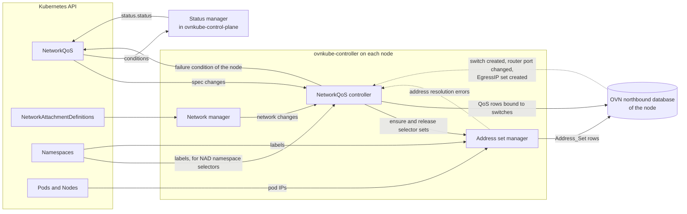
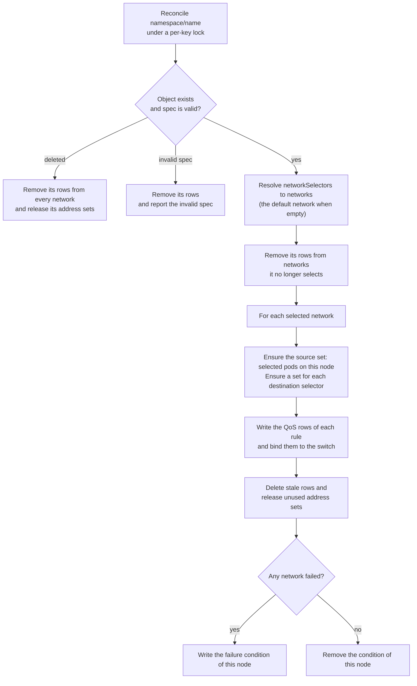

# NetworkQoS Level Driven Controller Design

## Introduction

The NetworkQoS controller turns each `NetworkQoS` object into OVN QoS rows that set the
DSCP of, and meter, the traffic of the selected pods on the selected networks. This page
describes how the controller is organized. See the
[usage guide](../features/network-qos/usage-guide.md) for the API and
[OKEP-4380](../okeps/okep-4380-network-qos.md) for the original proposal.

## Components

Each ovnkube-controller runs one NetworkQoS controller. It programs the OVN northbound
database of its node, on the default network and on every user defined or secondary
network that a `NetworkQoS` selects. Earlier versions created a NetworkQoS controller in
every network controller; each watched pods, namespaces and NADs and kept its own address
sets, so every event was processed once per network.

NetworkQoS controller does not watch pods. The address set manager, which NetworkPolicy and  
multicast also use, keeps an address set for each pod and namespace selector up to date.

## Reconciliation

Every event requeues the affected `NetworkQoS` objects by key. Reconciling a key reads the
latest object and brings every network to the desired state. A failure on one network does
not stop the others.

A switch that does not exist yet is not a failure: its creation requeues the policy.

## Where rules apply

Rules apply on the source node, before packets leave it.

| Network | Switch | Direction | Additional rows |
|---------|--------|-----------|-----------------|
| Default network | Node switch | `to-lport` | A row per rule sets the DSCP of packets that a router sends back into the switch, so that a lower-priority EgressQoS rule does not override it |
| Layer3 | Node switch of the network | `to-lport` | |
| Layer2 | Switch of the network | `from-lport` | On primary networks with EgressIP, a row per rule keeps the mark that EgressIP sets on the replies of the pods it serves |
| Localnet | Switch of the network | `to-lport` | |

A layer2 switch spans all nodes, so a packet to a pod on another node leaves the switch on
that node; rules there apply as packets enter the switch. Packets addressed to a router and
sent back into the same switch, such as Service traffic, pass the switch twice on the source
node. Each rule skips one of the passes, so its bandwidth limit applies once.

## Status

A node only writes its `Ready-In-Zone-<node>` condition when it fails to apply a
`NetworkQoS`, and removes it once it succeeds. The status manager in ovnkube-control-plane
sets `status.status` to `NetworkQoS Destinations not correctly applied` while any condition
reports a failure, and to `No NetworkQoS errors reported` otherwise.
