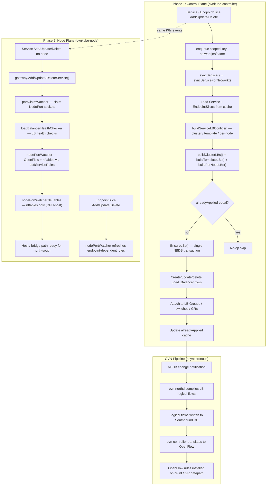

# Service Creation Workflow

This document describes how a Kubernetes Service is translated into OVN
load balancers and node-local gateway programming in OVN-Kubernetes, from
the moment the Service (and its EndpointSlices) appear until traffic can
be load-balanced to backends.

## Overview

Service networking is a **two-phase, loosely coupled** process:

1. **Control plane (ovnkube-controller)** — the services controller watches
   Services and EndpointSlices, builds abstract load-balancer configs, and
   creates or updates `Load_Balancer` objects in the OVN Northbound DB
   (NBDB). Those LBs are attached to logical switches, gateway routers, and
   Load Balancer Groups so east-west and north-south traffic hit the right
   VIP → backend mapping.
2. **Node plane (ovnkube-node)** — watches Services for host and gateway
   programming: OpenFlow on the external bridge (`breth0` / `br-ex`),
   nftables DNAT/SNAT rules, NodePort socket claims, and (for type
   LoadBalancer) a health-check server. This path handles traffic that
   enters or leaves via the host stack (especially local gateway mode,
   ETP=Local, and host → Service access).

There is no annotation handoff like pod creation. Both planes react to the
same Kubernetes Service / EndpointSlice events independently. The OVN
pipeline (`ovn-northd` → `ovn-controller`) still runs asynchronously after
NBDB updates.

At controller startup, **Services are started after nodes and before pods**
so node logical switches and Load Balancer Groups exist before LBs are
attached, which avoids load-balancer churn during pod bring-up.

See the [End-to-End Timeline](#end-to-end-timeline) below for the full
sequence.

## Which Services Are Handled

OVN-Kubernetes programs OVN load balancers only for Services that have a
real ClusterIP:

| Service type / case | Handled? | Notes |
|---|---|---|
| `ClusterIP` | Yes | Cluster-wide VIP → endpoints |
| `NodePort` | Yes | ClusterIP LBs plus per-node / template LBs for `<nodeIP>:<nodePort>` |
| `LoadBalancer` | Yes | Same as NodePort for OVN; ExternalIPs and LoadBalancer ingress VIPs are also programmed as VIPs. OVN does **not** answer ARP for those VIP types — the administrator (or a LoadBalancer provider such as MetalLB) must route traffic to the nodes |
| Headless (`ClusterIP: None`) | No | No OVN LB; DNS returns pod IPs directly |
| `ExternalName` | No | DNS CNAME only; no OVN LB |

## Phase 1: Control Plane — Service Reconciliation

### Event Handling

The services controller (`ovn-lb-controller`) registers informers for
Services, EndpointSlices, and Nodes. Any of the following enqueue a sync
for `namespace/name` (scoped per network for UDNs):

* Service Add / Update / Delete
* EndpointSlice Add / Update / Delete (resolved back to the owning Service).
  Default-network slices use the `kubernetes.io/service-name` label.
  UDN mirrored slices use the `k8s.ovn.org/service-name` label plus the
  `k8s.ovn.org/endpointslice-network` annotation to select the network
  scope; slices with neither are skipped
* Node changes that affect host addresses or chassis template variables
  (needed for NodePort VIPs and template LBs)

Workers pull keys from a rate-limited queue and call `syncService()`.
Transient OVN or API failures are retried with exponential backoff (up to
15 retries).

In interconnect mode each node is its own OVN zone: the local
`ovnkube-controller` writes LBs into that zone's NBDB. Cluster-wide VIP
mappings stay consistent because every zone watches the same Service and
EndpointSlice objects.

### Sync Path

`syncServiceForNetwork()` performs the following steps:

1. Load the Service from the informer cache.
2. **UDN-enabled default Services (exception)** — when the sync is for a
   **primary UDN** and the Service key is in
   `config.Default.UDNAllowedDefaultServices` (for example the Kubernetes
   API or cluster DNS), the controller does **not** build a UDN-scoped
   load balancer. It installs (or on delete, removes) a
   `LogicalRouterStaticRoute` on that UDN's cluster router that steers the
   Service ClusterIP toward the node's management IP, then returns. Look
   for that static route — not a UDN `Load_Balancer` — when debugging
   access to those default Services from a primary UDN.
3. If the Service is gone, or is not a ClusterIP-bearing type (Headless /
   ExternalName / no ClusterIP yet), delete any previously applied LBs for
   that owner and return.
4. List EndpointSlices for the Service (and network) and build node info
   for the local zone.
5. Build abstract LB configs, then concrete OVN LB objects:
   ```text
   buildServiceLBConfigs()
     → buildClusterLBs()
     → buildTemplateLBs()
     → buildPerNodeLBs()
   ```
6. Short-circuit if the desired LBs match the in-memory `alreadyApplied`
   cache (no OVN transaction).
7. Otherwise call `EnsureLBs()` — create / update / delete NBDB
   `Load_Balancer` rows in a single transaction, tagged with owner
   external IDs.

### Abstract LB Configs

`buildServiceLBConfigs()` classifies each Service port into one or more
of three buckets:

**Cluster-wide configs** — used for a standard ClusterIP (and for
ExternalIP / LoadBalancer ingress VIPs when `externalTrafficPolicy` is
not `Local`). One LB per protocol can be shared across the cluster via a
Load Balancer Group.

**Per-node configs** — required when the VIP or backends differ by node:

* NodePort services (VIP is each node's physical IP)
* Host-network endpoints (router targets need hairpin / masquerade IPs)
* `externalTrafficPolicy: Local` (backends filtered to local endpoints;
  gateway-router LBs use `skip_snat=true`)
* `internalTrafficPolicy: Local` (switch LBs use local endpoints only)

**Template configs** — an optimization for “plain” NodePort services
(no ETP=Local, no non-max session-affinity timeout) when Load Balancer
Groups and Chassis Template Variables are enabled. One template LB expands
per chassis to that node's IP and backends instead of creating N per-node
LB rows.

### OVN Load_Balancer Objects

`EnsureLBs()` writes `Load_Balancer` rows named for stable churn control:

```text
Service_<namespace>/<name>_<protocol>_<scope>
```

Examples:

* `Service_default/kubernetes_TCP_cluster`
* `Service_default/my-svc_TCP_node_router_ovn-worker`
* `Service_default/my-svc_TCP_node_switch_template_IPv4`

External IDs always include:

```text
k8s.ovn.org/kind=Service
k8s.ovn.org/owner=<namespace>/<name>
```

User-defined networks add network name / role external IDs so repair and
cleanup stay network-scoped.

LB options derived from the Service (`lbOpts()` / `buildLB()`):

* `reject=true` by default — when a VIP has no backends, OVN rejects the
  connection (TCP RST / ICMP unreachable depending on protocol). If
  empty-LB events are enabled (`OVNEmptyLbEvents`) and the Service is
  idle (or on the unidling grace period), `lbOpts()` sets `reject=false`
  and `event=true` instead, so an empty VIP does not request rejection
* Session affinity (`spec.sessionAffinity: ClientIP`) — either OVN
  `affinity_timeout` (when a non-max timeout is configured) or
  `selection_fields` of `ip_src` / `ip_dst` (when using the max timeout)
* Optional empty-LB events for the unidling / idle-at feature (see
  `reject` behavior above)
* `skip_snat=true` on ETP=Local gateway-router LBs so the client source IP
  is preserved
* `hairpin_snat_ip` set to the OVN service-hairpin masquerade addresses so
  pod → Service → same-pod hairpin traffic returns through the LB

### Attachment: Switches, Routers, and LB Groups

Where an LB is attached determines which traffic hits it:

| Attachment | Typical traffic |
|---|---|
| Node logical switch (via `clusterLBGroup` / `clusterSwitchLBGroup`) | Pod → ClusterIP / NodePort / ExternalIP (east-west) |
| Gateway router (via `clusterLBGroup` / `clusterRouterLBGroup`) | External / host → Service via GR (north-south; shared gateway) |
| Per-node switch / router (or template groups) | NodePort, ETP/ITP=Local, host-network backends |

With Load Balancer Groups enabled (the common interconnect path),
cluster-wide LBs are added to `clusterLBGroup` once; node switches and
gateway routers are already members of that group, so new Services do not
require per-node membership updates.

Example cluster-wide ClusterIP LB in NBDB:

```bash
$ ovn-nbctl list load_balancer Service_default/my-svc_TCP_cluster
_uuid               : <uuid>
name                : "Service_default/my-svc_TCP_cluster"
protocol            : tcp
vips                : {"10.96.0.50:80"="10.244.0.5:8080,10.244.2.5:8080"}
options             : {event="false", reject="true", skip_snat="false"}
external_ids        : {"k8s.ovn.org/kind"=Service, "k8s.ovn.org/owner"="default/my-svc"}
```

> [!NOTE]
> For `externalTrafficPolicy: Local`, OVN creates additional per-node LBs.
> On a node with only remote endpoints, the **gateway-router** VIP for that
> NodePort / ExternalIP / LoadBalancer address has empty targets so traffic
> is not forwarded off-node. With the default `reject=true`, OVN rejects
> that empty VIP; if empty-LB events are enabled and the Service is idle,
> `reject=false` so the empty VIP does not request rejection. The ordinary
> **node-switch** VIP for the same address can still list remote backends
> (used by east-west traffic). A separate **masquerade VIP** (for example
> `169.254.169.3`) on the switch maps only to local backends and is used
> after host nftables DNAT on local-gateway ETP=Local paths.

## Phase 2: Node Plane — Gateway and Host Programming

While the control plane owns OVN LBs, `ovnkube-node` programs the
host-facing path so packets that leave or enter OVN via the node still
reach the correct VIP.

### Service Watchers

Gateway initialization installs several Service handlers. On Add / Update /
Delete of a ClusterIP-bearing Service, `gateway.AddService` (and the update /
delete counterparts) invoke them in this order, collecting errors from each
rather than stopping on the first failure:

1. **`portClaimWatcher`** — claims NodePort (and related) sockets on the
   host so the ports stay reserved.
2. **`loadBalancerHealthChecker`** — health-check server for Services of
   type LoadBalancer (when NodePorts are enabled).
3. **`nodePortWatcher`** — used on a full node (shared or local gateway
   with OVS). Through `addServiceRules` it programs **both** OpenFlow on
   the shared gateway bridge (`breth0` / `br-ex`) **and** nftables DNAT /
   SNAT / management-port exceptions. It also implements EndpointSlice
   Add / Update / Delete so endpoint-dependent rules (for example ETP /
   host-network local endpoints) are refreshed when backends change —
   Service events alone are not enough for that path.
4. **`nodePortWatcherNFTables`** — used on DPU-host mode (no local OVS).
   It calls the same `addServiceRules` nftables path without OpenFlow.
   On a full node, nftables Service rules come from `nodePortWatcher`,
   not from this handler.

Handlers also resolve the active network for the Service namespace (default
or UDN) and skip work when that network is not active on the node.
Headless and ExternalName Services are skipped on the node plane as well.

### Shared vs Local Gateway

* **Shared gateway** — external Service traffic is steered into OVN and
  hits the gateway-router load balancer; SNAT / DNAT stay in the OVN /
  OVS datapath where possible.
* **Local gateway** — external Service traffic is delivered to the host
  first, then the path depends on `externalTrafficPolicy`. Ingress
  normally arrives via `breth0` → LOCAL into the host. When
  `AllowNoUplink` is enabled and the gateway bridge has no physical
  uplink port, that steering is skipped: traffic enters the host on the
  node's physical interface instead of `breth0`, so operators should
  inspect that NIC (and host nftables) rather than bridge OpenFlow for
  Service ingress.
  * **ETP=Cluster (default)** — host nftables DNATs NodePort / ExternalIP
    / LoadBalancer VIP to the Service **ClusterIP**, the packet is routed
    back into `breth0`, and the **gateway-router** load balancer performs
    the final DNAT to a backend. This path does **not** use
    `ovn-k8s-mp0` or a switch LB for that external VIP.
  * **ETP=Local (with NodePorts, OVN-networked local backends)** — host
    nftables DNATs the NodePort to the ETP-local masquerade IP (for
    example `169.254.169.3`), forwards into `ovn-k8s-mp0`, and a
    **node-switch** load balancer maps that masquerade VIP to local-only
    backends (preserving client source IP).
  * **ETP=Local without NodePorts** — a LoadBalancer Service with
    `allocateLoadBalancerNodePorts: false` has host nftables DNAT
    directly to local endpoints; that bypasses the OVN Service load
    balancers for the external VIP.

**Exception (both gateway modes):** for a Service with
`externalTrafficPolicy: Local`, `nodePortWatcher` decides the direct-host
path **per Service port and per IP family**. Only a port that still has
at least one **host-networked** endpoint local to the node (for that
address family) gets OpenFlow on `breth0` that DNATs the NodePort /
ExternalIP / LB VIP directly to the host endpoint and delivers via
LOCAL. Other ports or families on the same Service keep the non-host
path for that Service type: with NodePorts, nftables → `ovn-k8s-mp0` →
switch LB (local gateway) or GR `skip_snat` LB (shared gateway); with
`allocateLoadBalancerNodePorts: false`, the direct-to-endpoint nftables
DNAT path above — not the masquerade / switch-LB detour.

Host ↔ OVN Service steering uses link-local masquerade addresses (for
example host masquerade `169.254.169.2` / `fd69::2` and OVN masquerade
`169.254.169.1` / `fd69::1`) so the host and gateway router can share a
node IP without confusing return paths.

## End-to-End Timeline



### How the phases connect

* Both planes watch the **same Service and EndpointSlice APIs**; there is
  no shared annotation. Control-plane success means OVN LBs exist; node
  success means host/bridge rules exist. Either side can briefly lag.
* The OVN pipeline runs after NBDB commits:
  * **ovn-northd** turns `Load_Balancer` VIP maps into logical flows.
  * **ovn-controller** installs OpenFlow on `br-int` (and related
    datapaths) so pod traffic hitting a switch LB is DNAT'd to a backend.
* East-west ClusterIP traffic needs only Phase 1 + the OVN pipeline.
  North-south NodePort / ExternalIP / LoadBalancer traffic typically needs
  Phase 2 as well (and the correct gateway mode path).

### What happens if things go wrong

* If the **services controller is slow** (queue backlog, NBDB contention),
  pods may briefly see connection refused / no route to VIP until LBs are
  programmed; workers retry with exponential backoff up to 15 times. If
  those retries are exhausted (for example NBDB stays unavailable), the
  Service key is dropped from the queue — recovery needs a later enqueue
  (Service / EndpointSlice / node update, or controller restart), not
  NBDB recovery alone.
* If **EndpointSlices lag** behind ready pods, LBs may briefly have empty
  backends until the next EndpointSlice-driven sync. With the default
  `reject=true` that yields a TCP RST (or ICMP unreachable); idle
  Services with empty-LB events enabled keep `reject=false` instead.
* If **node OpenFlow / nftables programming fails**, ClusterIP from pods
  can still work while NodePort / ExternalIP from outside the node fails
  until the node watcher retries.
* If a Service mutates to Headless or ExternalName, `EnsureLBs(..., nil)`
  deletes all owned LBs so stale VIP DNAT does not remain.

## Failure Modes

* **No ClusterIP yet** — kube-apiserver has not allocated an IP; sync
  treats the Service as not ready and does not create LBs until a later
  update with `spec.clusterIP` / `spec.clusterIPs` set.
* **Stale LBs after crash** — startup repair scans NBDB for
  `k8s.ovn.org/kind=Service` rows whose owner no longer exists (or no
  longer qualifies) and deletes them.
* **ETP=Local with no local endpoints** — the per-node **gateway-router**
  VIP has empty targets so traffic is not forwarded off-node. Default
  `reject=true` rejects that empty VIP; idle Services with empty-LB
  events enabled use `reject=false` instead. The ordinary **node-switch**
  VIP may still retain remote backends for east-west traffic.
* **UDN / multi-network** — Services are synced per registered network;
  LBs and LB Groups are network-scoped. Node watchers skip namespaces
  whose network is not active on that node.

## Key Packages

* `go-controller/pkg/ovn/controller/services` — Service / EndpointSlice
  reconciliation, LB config build, `EnsureLBs`, repair
* `go-controller/pkg/libovsdb/ops` — typed NBDB load-balancer and LB group
  operations
* `go-controller/pkg/node` — gateway init, `nodePortWatcher`,
  `nodePortWatcherNFTables`, port claiming, LoadBalancer health checks
* `go-controller/pkg/util` — Service / EndpointSlice helpers, ClusterIP and
  traffic-policy predicates
