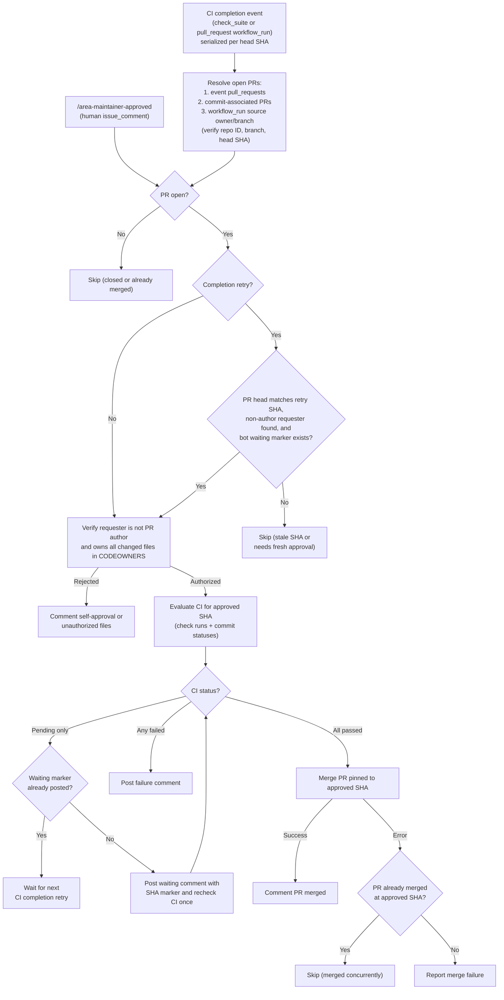

# Project Areas

ovn-kubernetes organises its codebase into **areas** — focused domains that are
owned by designated **Area Maintainers**. Each area has a clear scope of files
defined in [`CODEOWNERS`](https://github.com/ovn-kubernetes/ovn-kubernetes/blob/master/CODEOWNERS)
and a set of maintainers and reviewers responsible for its health.

For the full governance details — roles, responsibilities, appointment and
removal process — see [Area Maintainers](../governance/GOVERNANCE.md#area-maintainers)
in the governance docs.

## How Areas Work

* Every area is declared as a section in `CODEOWNERS` with a header comment
  identifying the Area Maintainer(s):
  ```
  # Virtualization (Area Maintainer: @user)
  ```
* GitHub automatically assigns reviewers from the listed owners when a PR
  touches files matching the area's patterns.
* Area Maintainers can merge PRs that **exclusively** touch files within their
  area by commenting `/area-maintainer-approved` on the PR. The merge bot
  (`.github/workflows/area-merge.yml`) verifies file scope, CI status, and
  authorization before merging.
* PRs that touch files across multiple areas require a repo Maintainer to merge.

## Merge Bot (ovn-kubernetes-merge-bot)

The area merge workflow uses a dedicated GitHub App called
**ovn-kubernetes-merge-bot** to perform merges. This is required because the
repository's branch protection rules restrict who can push to `master`. The
app is added to the branch protection allow-list, enabling it to merge PRs on
behalf of area maintainers once all checks pass.

**Configuration:**

| Item | Location |
|---|---|
| GitHub App | Installed on the `ovn-kubernetes` org ([app settings](https://github.com/organizations/ovn-kubernetes/settings/apps/ovn-kubernetes-merge-bot)) |
| Client ID | Repository variable: `OVN_KUBERNETES_MERGE_BOT` |
| Private key | Repository secret: `OVN_KUBERNETES_MERGE_BOT` |
| Branch protection | `master` — app listed under "Restrict who can push to matching branches" |

The workflow generates a short-lived installation token via
[`actions/create-github-app-token`](https://github.com/actions/create-github-app-token)
at the start of each run. No long-lived access tokens are used during workflow execution.

### Waiting for CI and automatic retries

If an authorized `/area-maintainer-approved` request finds pending CI checks
and no failures, the bot posts a waiting comment containing a marker for the
PR's current head commit SHA. A head commit with no check runs and no commit
statuses is also treated as pending, because its CI has not started yet. So
is a `pull_request` workflow run that has not completed or that awaits
maintainer approval, even before its jobs report checks; one that completed
without passing counts as failed. The bot retries when it receives either:

* A `check_suite: completed` event. GitHub Actions-created check suites do not
  trigger this workflow event.
* A `workflow_run: completed` event for `ovn-ci`, `DPU Offload`,
  `performance-test`, `Test Docs Build`, `License Header Check`, or `Script tests`,
  provided the completed workflow was triggered by `pull_request`.

A commit status that changes after these events does not trigger a retry. If
the bot is still waiting on a commit status once the listed workflows have
finished, issue `/area-maintainer-approved` again when that status passes.

The CI gate ignores the merge bot's own check and the GitHub Actions
`labeler`, `approval-labeler`, and `review` helper jobs. These jobs maintain
labels or forward review events; their completions do not trigger merge
retries. Their results also do not count as CI having started. When a
workflow ran more than once for the commit, for example after the PR was
closed and reopened, only the latest result of each of its jobs counts.
Jobs with the same name in different workflows, such as `Build-PR` in
`ovn-ci` and `performance-test`, are evaluated separately.

Each retry rechecks the PR's current head, the bot-authored waiting marker,
the requester's area authorization, and all CI results before attempting a
merge pinned to that SHA. Completion events for older commits are ignored.
**After pushing new commits, obtain a new `/area-maintainer-approved` request
after review**; the old waiting marker does not authorize the new head.
Completion retries for the same SHA are queued and processed one at a time;
a later retry skips a PR that has already merged.

Fork PRs are supported even when the completion event's `pull_requests` list
is empty. The bot first looks up open PRs associated with the completed
commit whose current head still matches it. If no matching PR is found for
a workflow completion, it looks up open PRs by source owner and branch, then
verifies the source repository, branch, and head SHA before applying the
same approval and CI checks.



## Current Areas

### Virtualization

| | |
|---|---|
| **Scope** | KubeVirt integration, live migration, multi-homing, localnet |
| **Area Maintainer** | [@maiqueb](https://github.com/maiqueb) |
| **Reviewers** | [@qinqon](https://github.com/qinqon), [@ormergi](https://github.com/ormergi) |

**Files:**

| Category | Paths |
|---|---|
| E2E tests | `/test/e2e/kubevirt.go`, `/test/e2e/kubevirt/`, `/test/e2e/multihoming.go`, `/test/e2e/multihoming_utils.go`, `/test/e2e/multihoming_external_router_utils.go`, `/test/e2e/network_segmentation_localnet.go`, `/test/e2e/localnet-underlay.go`, `/test/e2e/network_segmentation_preconfigured_layer2.go` |
| Unit tests | `/go-controller/pkg/ovn/kubevirt_test.go`, `/go-controller/pkg/ovn/multihoming_test.go`, `/go-controller/pkg/ovn/multipolicy_test.go`, `/go-controller/pkg/ovn/layer2_user_defined_network_controller_test.go`, `/go-controller/pkg/util/multi_network_test.go`, `/test/crd-integration/testscenario/cudn/valid-scenarios-localnet.go`, `/test/crd-integration/testscenario/cudn/invalid-scenarios-localnet-*.go` |
| Production code | `/go-controller/pkg/kubevirt/`, `/go-controller/pkg/util/arp.go`, `/go-controller/pkg/util/ndp/` |
| Docs | `/docs/features/live-migration.md`, `/docs/features/multiple-networks/multi-homing.md`, `/docs/features/multiple-networks/multi-network-policies.md` |

## Adding a New Area

1. Open a PR proposing the new area — the PR must be approved by the repo
   Maintainers (see [Governance](../governance/GOVERNANCE.md#area-maintainers)).
2. Add a new section to `CODEOWNERS` with the file patterns and the proposed
   Area Maintainer in the section header comment.
3. Add an entry to this document describing the area's scope, maintainer(s),
   and reviewers.
4. Once merged, the Area Maintainer can begin using `/area-maintainer-approved`
   to merge qualifying PRs.
