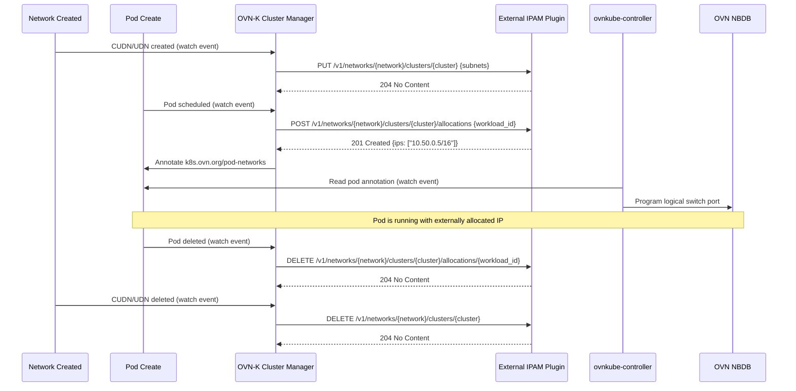
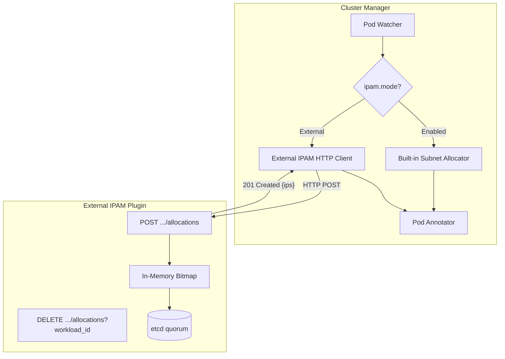
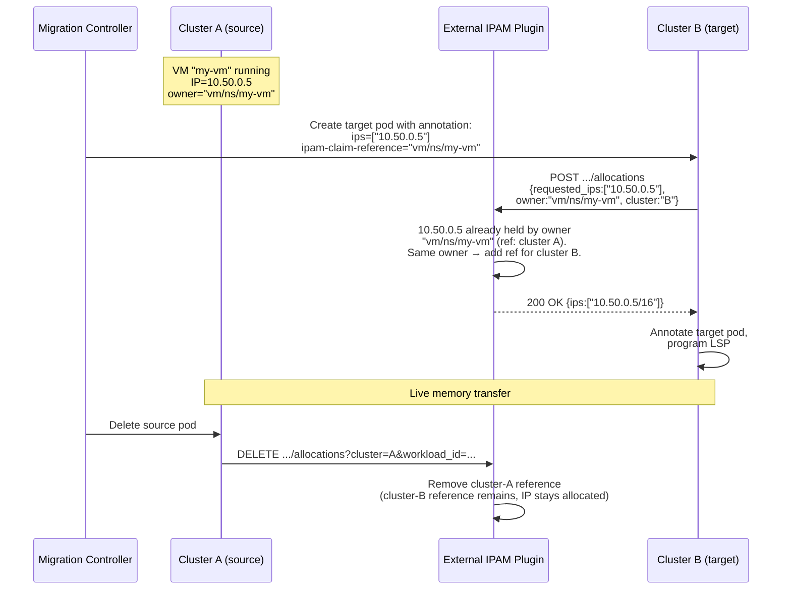

# OKEP-6831: External IPAM Plugin Support

* Issue: [#6831](https://github.com/ovn-kubernetes/ovn-kubernetes/issues/6831)

## Problem Statement

OVN-Kubernetes supports three IPAM modes for Cluster User Defined Networks:
`Enabled` (OVN-Kubernetes allocates from subnets), `Disabled` (no IP assignment,
Secondary only), and `DHCP` (delegates to external DHCP server, Secondary
Localnet only per [OKEP-6224](../okep-6224-dhcp-ipam-localnet.md)). There is no
mechanism to delegate IP allocation to an external service for
primary Layer2 UDNs/CUDNs — the topology used for stretching EVPN transport
Layer2 type networks across clusters. Multi-cluster deployments need a centralized
IPAM service management to allocate IPs from a single flat pool across all clusters,
guaranteeing uniqueness without CIDR partitioning or address waste.

## Goals

- Introduce a new IPAM mode (`External`) for primary Layer2
  CUDNs that allows admins to create networks whose IPAM is delegated
  to an external HTTP-based IPAM service.
- Support multi-cluster deployments where a single external IPAM
  instance manages a flat IP pool across all clusters running OVN-Kubernetes.
- Define a stable HTTP API contract in a dedicated schema repository
  (`ovn-kubernetes/external-ipam-api`) that both OVN-Kubernetes (client)
  and any conforming backend (server) import. The contract is
  language-agnostic (OpenAPI 3.1); generated Go types and a conformance
  suite ship alongside it.
- Enable OVN-Kubernetes to call the external plugin during pod add,
  receive an IP allocation from the external service, annotate the pod with
  that IP, and program the OVN logical switch port — all opaque to the workload
  or user.
- Support static IP requests via the existing OKEP-5233 pod annotation
  (`v1.multus-cni.io/default-network` with `ips` field), routed
  through the external plugin as `requested_ips`.
- Deliver a production-ready external IPAM service (`Atlas`), under the `ovn-kubernetes`
  GitHub organization. This service will be agnostic to the platforms it serves and will
  be built as the first conforming backend of the new API contract. The IPAM service
  itself will have no knowledge of UDNs or anything specific to Kubernetes or OVN-Kubernetes.
  It will be a simple, "allocate IP" service. It will be used for conformance tests,
  so third party external IPAMs in future can build their own integration using this
  as an example implementation for the API contract.
- Support cross-cluster live VM migration IPAM by introducing
  owner-based allocation semantics: the same logical entity (VM) can
  re-acquire its IP on a different cluster without conflict.
- Support overlapping IP address spaces across different networks:
  the plugin tracks allocations per-network, allowing the same IP
  range to be used independently by different UDNs without conflict.
- Support IPv4-only, IPv6-only, and dual-stack pools from day one. The
  plugin allocates from whichever address families a network is
  configured with; a dual-stack network yields one IPv4 and one IPv6
  address per attachment, tracked as distinct allocations under the same
  owner.
- Support multiple IPs per address family on a single workload
  attachment. The plugin API should be designed to allocate more than
  one IPv4 (or IPv6) address per pod interface or multiple interfaces on the same network,
  so that when OVN-Kubernetes gains multi-IP-per-family-per-network
  support in future the plugin contract does not need to change.
- High availability from day 0: The external IPAM must support multiple
  replicas with leader election so that IP allocation is not a single
  point of failure. Active-passive failover with state replication
  ensures zero downtime during upgrades and node failures.
- Platform-agnostic API and deployment: the external IPAM HTTP contract
  uses opaque `workload_id` strings (not Kubernetes-specific fields
  like pod/namespace) and runs as a standalone Go binary that can be
  deployed on Kubernetes, bare-metal, or VMs. Non-Kubernetes callers
  (e.g. VMware vSphere, OpenStack Neutron) can use the same API by
  constructing `workload_id` from platform-native identifiers.

## Future Goals

- Supporting `External` mode for UDNs. Whether tenants should have
  the ability to specify an external IPAM solution for their networks
  or not is out of scope for the initial OKEP. Current OKEP targets
  only admin use cases.
- Supporting `External` mode on Layer3 Primary Networks and
  Layer3/Layer2/Localnet Secondary Networks.
- Supporting `External` mode on the Cluster Default Network (CDN).
  The initial scope targets only Layer2 Cluster User Defined Networks;
  extending it to the CDN is a separate use case.
- Multiple external IPAM backends per cluster, where different networks
  use different plugins (e.g. Atlas for one network, Infoblox for
  another), with per-backend credentials via an `ExternalIPAMBackend`
  CRD.
- Integration with enterprise IPAM systems (Infoblox, BlueCat) via
  adapter plugins (see [Enterprise DHCP/DDI (DNS-DHCP-IPAM) Integration](#future-goal-enterprise-dhcpddi-integration)).
- Integration with [NetBox](https://netbox.readthedocs.io/) as a
  persistence backend, so that all pod IP allocations
  are visible in a single-pane-of-glass IPAM tracking system alongside
  the rest of the organization's network infrastructure.
- DNS record management: creating forward (A/AAAA) and reverse (PTR)
  records on allocate and removing them on release. See
  [OKEP-6641](https://github.com/ovn-kubernetes/ovn-kubernetes/pull/6642).

## Non-Goals

- Replacing the existing `Enabled` IPAM mode for clusters that do not
  need external orchestration.
- Implementing a full-featured enterprise IPAM system within
  OVN-Kubernetes itself.
- Implementing DHCP-based IPAM (covered by OKEP-6224, supports
  Secondary Localnet only).
- Supporting mutation of an `External`-mode network's IPAM
  configuration (subnets, `externalIPAM` endpoint, mode) after
  creation. The initial implementation treats this configuration as
  immutable — corrections require deleting and recreating the network.
  Mutable/UPDATE support may be revisited if the use case (e.g.
  correcting a misconfigured network without tearing down existing
  workloads) gains traction.
- Supporting mutation of a workload's requested IP after it has been
  allocated. The IP bound to a workload endpoint is immutable for the
  lifetime of that workload — changing it requires recreating the
  workload so it goes through a fresh allocation.
- Surviving the loss of the external IPAM service and its backing store.
  Node and AZ failures are covered; loss of the service together with
  its database is platform-level DR (see
  [State Management and High Availability](#state-management-and-high-availability)).

## Introduction

Multi-cluster Kubernetes deployments increasingly require stretched L2
networks — a single broadcast domain spanning multiple clusters — for
workload mobility, disaster recovery, and simplified service discovery.
OVN-Kubernetes supports EVPN (OKEP-5088) which enables Layer 2 CUDN
segments to be stretched across the external network fabric using
MAC-VRFs and VXLAN. This is critical for VM migration: a VM can
migrate from an external provider network into a Kubernetes cluster
(or between clusters) while preserving its IP and MAC address,
because both endpoints share the same L2 broadcast domain via EVPN.

OKEP-5088 explicitly lists "interconnecting two Kubernetes clusters
with EVPN and allowing VM migration across them" as a future goal.
This OKEP provides the IPAM component needed to realize that goal:
when pods or VMs across clusters share the same L2 EVPN subnet, IP
address uniqueness must be enforced globally, not per-cluster.

Without a centralized allocator, the only alternative is to
pre-partition the subnet into per-cluster blocks using
`reservedSubnets`. For example, splitting a /16 across 10 clusters
means each cluster gets a /20 (4096 IPs). This approach has serious
drawbacks:

- **Address waste**: A cluster running 50 pods still consumes a /20.
  At 100 clusters the waste is enormous.
- **Rigid planning**: The operator must predict per-cluster capacity
  upfront. Growing a cluster beyond its partition requires subnet
  re-planning and potential IP renumbering.
- **No workload mobility**: Moving a VM from cluster A to cluster B
  means it must change IP (its old IP belongs to A's partition),
  breaking existing connections and firewall rules.
- **Combinatorial complexity**: Dual-stack, multiple subnets per AND,
  and heterogeneous cluster sizes make the partition math unwieldy
  and error-prone.
- **Churn on cluster add/remove**: Adding a cluster means carving a
  new partition out of the pool (and possibly renumbering existing
  ones to make room); removing a cluster strands its partition until
  it is manually reclaimed. Neither is a trivial, self-service
  operation — each requires re-planning the global CIDR layout.

A centralized external IPAM service eliminates all of these issues by
allocating from a single flat pool on demand.

Note that the address-waste drawback is predominantly an IPv4
concern. IPv6's vast address space makes per-cluster slicing far less
wasteful — a /64 per cluster carved out of a larger prefix costs
effectively nothing in address terms. The remaining drawbacks still
apply to IPv6, but the primary motivation for a flat pool — avoiding
exhaustion and waste — is IPv4-driven. However, `External` mode is
not split per address family: when enabled on a network, it owns
allocation for all configured families. Mixing authorities (e.g.
External for IPv4, built-in for IPv6) is not supported — it would
split the allocation contract and complicate cross-cluster migration.

Today, OVN-Kubernetes offers two relevant modes for primary Layer2 CUDNs:

- `Enabled`: OVN-Kubernetes's built-in allocator manages IPs, but it operates
  per-cluster with no cross-cluster coordination.
- `Disabled`: Only supported for Secondary networks. Even if it were
  available for Primary, it provides no automation — someone must
  statically assign every IP.

The `DHCP` mode (OKEP-6224) delegates to an external DHCP server but is
restricted to Secondary Localnet networks, requires L2 reachability to
the DHCP server at CNI ADD time, and doesn't fit the Primary L2 overlay
multi cluster IPAM use case.

## User-Stories/Use-Cases

### Story 1: Multi-Cluster Flat IP Pool

As a platform operator running stretched L2 networks across multiple
clusters, I want all pods on the same primary Layer2 CUDN to receive
unique IPs from a single flat pool without pre-partitioning CIDRs per
cluster, so that I can schedule workloads freely across clusters without
address conflicts or wasted IP space.

For example: with `reservedSubnets` partitioning, an operator must
manually divide a /16 into per-cluster blocks (e.g. /20 per cluster),
predict per-cluster capacity upfront, and recalculate whenever clusters
are added or workload distribution shifts. Every major CNI that
supports multi-cluster networking today imposes this same constraint —
non-overlapping CIDRs must be manually planned per cluster:

- [Cilium Cluster Mesh](https://docs.cilium.io/en/latest/network/clustermesh/setup/):
  Requires "PodCIDR ranges in all clusters must be non-conflicting
  and unique." Each cluster is manually assigned a disjoint range
  (e.g. cluster1: 10.1.0.0/16, cluster2: 10.2.0.0/16). No shared
  flat pool.
- [Calico Cloud Cluster Mesh](https://docs.tigera.io/calico-cloud/multicluster/kubeconfig):
  Supports multi-cluster via VXLAN or WireGuard overlay, but
  requires "Pod CIDRs between clusters must not overlap." IPAM
  remains per-cluster; the operator ensures uniqueness manually.
- [Kube-OVN (OVN-IC)](https://kubeovn.github.io/docs/v1.14.x/en/advance/with-ovn-ic/):
  Interconnects clusters via OVN-IC tunnels, but requires "subnet
  CIDRs in different clusters MUST NOT be overlapped" for
  auto-routing. Overlapping subnets need manual route configuration.

None of these provide a single flat IP pool with automated
cross-cluster allocation, nor do they support multi-network (multiple
isolated subnets per cluster with overlapping address spaces). They
all push the CIDR partitioning burden onto the operator. A centralized
external IPAM eliminates this planning entirely — allocations come from
a single flat pool on demand, regardless of which cluster or node the pod lands on.

### Story 2: Enterprise IPAM Integration (In Future)

As a network administrator, I want OVN-Kubernetes to delegate IP
allocation for primary CUDN pods to my existing enterprise IPAM system
(via an HTTP adapter), so that Kubernetes workloads follow the same IP
governance and audit trail as my non-Kubernetes infrastructure.

### Story 3: Controlled IP Assignment for Compliance

As a security engineer, I want IP allocations for sensitive workloads on
isolated primary CUDNs to be managed by a central service with audit
logging, so that I can track which pod received which IP and when,
across all clusters in the fleet.

### Story 4: IP Recycling

As a cluster operator, I want an IP to be reclaimed once the workload
that held it is gone, so that the address returns to the pool and
future workloads can use it — without any address leaking permanently
out of the usable range.

### Story 5: Static IP / Pre-Reserved Address

As a virtualization operator, I want to assign a specific IP from the
network's subnet to a particular VM (or pod) and have the external
IPAM honor and reserve exactly that address, so that workloads with
fixed-address requirements — licensing tied to an IP, firewall rules,
externally published endpoints — keep the same address across
restarts and reschedules. The allocator must reject the request if
that address is already held by a different workload.

### Story 6: Cross-Cluster Live VM Migration

As a platform operator, I want a virtual machine live-migrating from
cluster A to cluster B to retain its IP address seamlessly, so that
existing connections, DNS records, and firewall rules remain valid
without manual reconfiguration after migration completes.

### Story 7: Cross-Platform Migration

As an infrastructure team migrating a fleet of VMs from an existing
platform into Kubernetes — VMware vSphere to OpenShift Virtualization
(KubeVirt), or between any two platforms that share an L2 domain — I
want OVN-Kubernetes to delegate to the same Atlas IPAM instance that
already governs the source environment, so one authority tracks every
allocation across both sides for the whole migration. Atlas serves the
legacy platform and the Kubernetes target simultaneously, so VMs move at
whatever pace the team chooses (weeks or months) while keeping their
IPs, and the two sides can never hand out the same address. I do not
have to reconcile two independent IP databases or freeze allocations
while the migration is in flight. Once it completes, Atlas serves the
Kubernetes platform alone with no reconfiguration. The requirement is
explicit: both environments must point at one shared external IPAM —
separate per-platform allocators reintroduce exactly the
cross-environment conflict this feature exists to eliminate.

## Proposed Solution

This OKEP introduces `ipam.mode: External`, which tells OVN-Kubernetes
to call an external HTTP endpoint for each pod that needs an IP on a
primary Layer2 CUDN. The external service owns the allocation logic,
collision avoidance, and persistence — it is what actually allocates and
releases IPs. OVN-Kubernetes drives it by calling `allocate` on pod
create and `release` on pod delete, and handles everything downstream of
the allocation: annotating the pod and programming the OVN logical switch
port.

This is a generic extension point. Any external IPAM system that
implements the HTTP contract can serve as the backend — from the
first-party Atlas allocator to enterprise systems like Infoblox or BlueCat.
Network orchestrators that create L2 EVPN subnets via CUDNs across
clusters are one consumer, but the feature is not specific to any
single orchestrator.

### Architecture Overview



We considered having ovnkube-node call the plugin directly during CNI
ADD (as in the DHCP OKEP-6224 flow) to trade the annotation round-trip
for lower pod-startup latency, but chose the cluster-manager for primary
Layer2 for three reasons:

- **L2 allocation is already centralized there.** Primary Layer2 needs a
  cluster-wide view to assign both the IP and the per-port tunnel key,
  which lives in the cluster-manager; ovnkube-node has no equivalent
  central authority. (Localnet programs the LSP at the node, but that
  path does not apply to the overlay L2 topology this OKEP targets.)
- **The annotation hop is unavoidable today regardless.**
  ovnkube-controller programs the logical switch port from the
  `k8s.ovn.org/pod-networks` annotation, so *something* must annotate.
  Having ovnkube-node call the plugin would only move where the call
  originates, not remove the hop — so it buys nothing until
  ovnkube-controller and ovnkube-node are collapsed into one process.
- **One connection pool per cluster, not per node.** A cluster-manager
  caller holds a single persistent, pooled (keep-alive) connection set
  to the plugin per cluster, reused across all pod allocate/release calls;
  an ovnkube-node caller would hold one per node, multiplying connection
  count and plugin-side fan-in.

If controller and node are ever merged, an ovnkube-node-local call
becomes worth revisiting; until then it adds the per-node connection
cost without removing the annotation hop.

### Multi-Cluster Design and Assumptions

In a multi-cluster deployment, several clusters whose L2 networks are
stretched across them share a single external IPAM plugin instance so
that they draw from one flat IP pool per network. Each cluster's
`ovnkube-cluster-manager` calls the same plugin, identified by the URL
configured in `externalIPAM.url` on the CUDN. A network orchestrator
typically creates the CUDNs and replicates them to every cluster so that
the same network definition (and therefore the same `externalIPAM.url`)
is present everywhere. The `cluster` field in each allocation request
identifies which cluster is requesting the IP, for deduplication and
audit. (The concrete deployment topology — service exposure and
cross-cluster authentication — is covered under
[Atlas IPAM → Deployment](#deployment).)

Multi-cluster assumptions:

This design relies on two "sameness" assumptions consistent with the
[Kubernetes MCS API](https://github.com/kubernetes/enhancements/tree/master/keps/sig-multicluster/1645-multi-cluster-services-api)
model:

1. **Namespace sameness**: A namespace with a given name is considered
   the same logical namespace across all clusters. For example,
   `tenant-a` in cluster A and `tenant-a` in cluster B represent the
   same tenant. This is required for owner-based concurrent references
   during cross-cluster VM migration — the owner identity
   `vm/tenant-a/my-vm` must resolve to the same logical entity on
   both clusters.

2. **Network sameness**: A network with a given name is considered the
   same logical network across all clusters. For example,
   `blue-network` in cluster A and `blue-network` in cluster B share
   a single flat IP pool in the plugin. This is how the plugin knows
   that `register` calls from different clusters for the same
   network name should map to the same pool. When a network
   orchestrator manages the CUDNs, consistent naming is guaranteed.
   In standalone deployments, the operator must ensure consistent
   network naming across clusters.

### API Details

#### New IPAM Mode

Extend the `IPAMMode` enum:

```diff
- // +kubebuilder:validation:Enum=Enabled;Disabled;DHCP
+ // +kubebuilder:validation:Enum=Enabled;Disabled;DHCP;External
type IPAMMode string

const (
    IPAMEnabled  IPAMMode = "Enabled"
    IPAMDisabled IPAMMode = "Disabled"
    IPAMDHCP     IPAMMode = "DHCP"
+   IPAMExternal IPAMMode = "External"
)
```

#### New ExternalIPAM Configuration

Add an `ExternalIPAM` struct to the IPAM configuration:

```diff
type IPAMConfig struct {
    // Mode controls IP allocation strategy.
    // +optional
    Mode IPAMMode `json:"mode,omitempty"`

    // Lifecycle controls IP lifecycle (Persistent for IPAMClaims).
    // +optional
    Lifecycle NetworkIPAMLifecycle `json:"lifecycle,omitempty"`

+   // ExternalIPAM configures the external IPAM plugin endpoint.
+   // Required when mode is "External".
+   // +optional
+   ExternalIPAM *ExternalIPAMConfig `json:"externalIPAM,omitempty"`
}

+ // ExternalIPAMConfig defines the connection parameters for an
+ // external IPAM service.
+ type ExternalIPAMConfig struct {
+     // Name is a human-readable identifier for this external IPAM
+     // plugin instance. Used in logs, events, and status conditions
+     // to distinguish between different plugin backends.
+     // Example: "prod-ipam", "infoblox-east", "atlas-ipam"
+     //
+     // +kubebuilder:validation:Required
+     // +kubebuilder:validation:MinLength=1
+     // +required
+     Name string `json:"name"`
+
+     // URL is the base URL of the external IPAM plugin HTTP endpoint.
+     // Must be a valid HTTP or HTTPS URL whose host is resolvable and
+     // routable from the node network namespace (see "Reachability"): a
+     // NodePort, LoadBalancer, Ingress hostname, or external DNS name.
+     // A *.svc.cluster.local name will NOT resolve for this client.
+     // Example: "https://external-ipam.example.net:9500"
+     //
+     // +kubebuilder:validation:Required
+     // +kubebuilder:validation:Pattern=`^https?://`
+     // +required
+     URL string `json:"url"`
+
+     // CABundle is a PEM-encoded CA certificate bundle for validating
+     // the plugin's (server's) TLS certificate. If unset and URL is
+     // HTTPS, the system trust store is used.
+     // +optional
+     CABundle []byte `json:"caBundle,omitempty"`
+
+     // TimeoutSeconds is the maximum time to wait for a response from
+     // the plugin. Defaults to 5 seconds.
+     // +optional
+     // +kubebuilder:validation:Minimum=1
+     // +kubebuilder:validation:Maximum=60
+     // +kubebuilder:default=5
+     TimeoutSeconds int32 `json:"timeoutSeconds,omitempty"`
+ }
```

`ExternalIPAMConfig` is a connection descriptor: where the plugin
is (`url`), how to verify it (`caBundle`), and how long to wait
(`timeoutSeconds`). The client credential is per-cluster, not
per-network (see [Per-Cluster Client Identity](#per-cluster-client-identity)).
Backend configuration (pool policies, DNS, recycling) is the plugin
operator's concern, opaque to OVN-Kubernetes.

Interaction with `Lifecycle`: `Lifecycle: Persistent` applies to
External IPAM networks. The IPAMClaim identity is passed as the `owner`
field on `allocate`. The existing CEL rule restricting
`Lifecycle: Persistent` to `ipam.mode: Enabled` must be relaxed to
also allow `External` — see [CRD Validation Rules](#crd-validation-rules).

#### Per-Cluster Client Identity

The client credential is per-cluster, so it does not belong in
`ExternalIPAMConfig` — that config is replicated identically to every
cluster, so a credential placed there would give every cluster the same
identity. Each cluster must supply its own mTLS client certificate,
signed by a CA the plugin trusts (see
[TLS, Trust, and Identity](#tls-trust-and-identity)). Issuance and
renewal are the operator's PKI concern (typically
[cert-manager](https://cert-manager.io/)). cluster-manager reloads a
renewed certificate in place without restarting.

The feature is gated behind a Helm value (`externalIPAM.enabled`), which
mounts a Secret containing `tls.crt` and `tls.key` to a well-known
directory (`--external-ipam-cert-dir`) and enables the External IPAM
code path. cluster-manager uses this credential for all External IPAM
calls. If the cert directory is absent or empty, cluster-manager starts
normally — External IPAM calls fail only when a pod on an External IPAM
network actually needs allocation. This ensures the credential never
blocks cluster-manager startup. This assumes all External IPAM networks
on a cluster share one backend, which is the initial target.

If a future use case requires multiple backends per cluster (e.g.
network A on Atlas, network B on Infoblox), a cluster-scoped
`ExternalIPAMBackend` CRD could pair each backend URL with its own
credential and CA, with the CUDN referencing it by name. This can be
added in a backwards-compatible way alongside `--external-ipam-cert-dir`.

#### CRD Validation Rules

```yaml
# Layer2 topology validations for External mode:
- message: "External ipam.mode requires externalIPAM configuration"
  rule: >-
    !has(self.ipam) || !has(self.ipam.mode) ||
    self.ipam.mode != "External" ||
    (has(self.ipam.externalIPAM) && has(self.ipam.externalIPAM.url))

- message: "Subnets are required when ipam.mode is External"
  rule: >-
    !has(self.ipam) || !has(self.ipam.mode) ||
    self.ipam.mode != "External" || has(self.subnets)

- message: "externalIPAM must be unset when ipam.mode is not External"
  rule: >-
    !has(self.ipam) || !has(self.ipam.externalIPAM) ||
    (has(self.ipam.mode) && self.ipam.mode == "External")

- message: "External ipam.mode is only supported for Primary network"
  rule: >-
    !has(self.ipam) || !has(self.ipam.mode) ||
    self.ipam.mode != "External" || self.role == "Primary"

- message: "reservedSubnets is not supported with External ipam.mode"
  rule: >-
    !has(self.ipam) || !has(self.ipam.mode) ||
    self.ipam.mode != "External" || !has(self.reservedSubnets)

# Relax the EXISTING IPAMConfig rule — today it is:
#   "!has(self.lifecycle) || self.lifecycle != 'Persistent' ||
#    !has(self.mode) || self.mode == 'Enabled'"
# which forbids Persistent + External. It must be widened to allow
# External, so IPAMClaims/owner-based persistence work on External networks:
- message: "lifecycle Persistent is only supported when ipam.mode is Enabled or External"
  rule: >-
    !has(self.lifecycle) || self.lifecycle != "Persistent" ||
    !has(self.mode) || self.mode == "Enabled" || self.mode == "External"

# Layer3Config and LocalnetConfig — reject External mode entirely:
- message: "External ipam.mode is only supported for Layer2 topology"
  rule: >-
    !has(self.ipam) || !has(self.ipam.mode) ||
    self.ipam.mode != "External"
```

Note: `External` mode is restricted to primary Layer2 CUDNs because:

1. Primary L2 is the topology used for stretched multi-cluster subnets
   (EVPN).
2. For L2, IPAM is managed by cluster-manager (centralized), making it
   natural to delegate outward.
3. For L3, IPAM is per-node (distributed), which doesn't map to a
   centralized external service.
4. Secondary networks already have `Disabled` mode available for
   manual/external IP management.

Unlike `Disabled` mode, `External` mode requires the `subnets`
field so that OVN-Kubernetes knows the address space (for gateway IP
derivation, route injection, port security ranges, network policies
configuration). The external plugin is responsible for allocating within
that range, but OVN-Kubernetes needs the subnets and IPs for datapath programming.

How the Layer2 subnet fields map to the plugin. The existing Layer2
address fields carry over to `External` mode as follows:

| CUDN Layer2 field | Type | Role | External-mode mapping |
|---|---|---|---|
| `subnets` | CIDRs | the pool | register `subnets` |
| `infrastructureSubnets` | CIDRs | ranges that cannot be assigned to workloads | register `exclude_subnets` (hard) |
| `defaultGatewayIPs` | IPs | gateway IP(s) | register `exclude_ips` (hard) |
| `reservedSubnets` | CIDRs | *soft*: no auto-alloc, but static still allowed | rejected (CEL); not supported |
| `joinSubnets` | CIDRs | OVN internal topology | not workload IPs; not sent to the plugin |

`infrastructureSubnets` and `defaultGatewayIPs` are already constrained by
the CUDN API to lie within `subnets`. `reservedSubnets` is rejected because
its *soft* semantics (excluded from automatic allocation but still usable
for static requests) existed only because OVN-Kubernetes was not the
allocator for out-of-cluster VMs; with Atlas as the central authority that
is obsolete. A future plugin feature could reintroduce a
no-dynamic/static-OK range if a use case emerges.

"Hard exclusion" means an `exclude_ips` IP, or any IP inside an
`exclude_subnets` range, is never handed out — neither by dynamic
allocation nor via a static `requested_ips`, which is rejected with `409`.

#### Example ClusterUserDefinedNetwork

```yaml
apiVersion: k8s.ovn.org/v1
kind: ClusterUserDefinedNetwork
metadata:
  name: blue-network
spec:
  namespaceSelector:
    matchLabels:
      network.example.io/subnet: "blue"
  network:
    topology: Layer2
    layer2:
      role: Primary
      subnets:
        - "10.50.0.0/16"
      infrastructureSubnets:
        - "10.50.0.0/28"
      defaultGatewayIPs:
        - "10.50.0.1"
      ipam:
        mode: External
        lifecycle: Persistent
        externalIPAM:
          name: "atlas-prod"
          url: "https://external-ipam.example.net:9500"
          caBundle: <PEM CA that signed the plugin's server cert>
          timeoutSeconds: 5
```

#### Configuration

New Helm values and cluster-manager flags:

- `externalIPAM.enabled` — feature gate. When true, mounts the client
  cert Secret and enables the External IPAM code path.
- `externalIPAM.clusterName` (`--cluster-name`) — cluster identity
  string used in all External IPAM API calls. Required when enabled.

### External IPAM Plugin API Contract

This design defines an open plugin interface via the HTTP API
contract in `ovn-kubernetes/external-ipam-api`. Any conforming backend
can implement it — from the first-party Atlas allocator to enterprise
IPAM systems like Infoblox, BlueCat, or NetBox. OVN-Kubernetes is the
client; the `externalIPAM.url` field in the CUDN spec points it at
whichever implementation is deployed.

#### Schema Source of Truth and Code Generation

The [`openapi.yaml`](openapi.yaml) committed alongside this OKEP is the
design-time contract — the agreed definition the HTTP API derives
from, not the shipped API reference.

At implementation the contract moves to a dedicated schema repository,
`ovn-kubernetes/external-ipam-api`, decoupled from both the client
(OVN-Kubernetes) and any server (Atlas, enterprise adapters). Go types
and interfaces are generated from the OpenAPI spec via
[`oapi-codegen`](https://github.com/oapi-codegen/oapi-codegen).
OVN-Kubernetes imports the generated client; Atlas and any third-party
backend import the generated server interface. A conformance test suite
ships alongside the schema. Neither side privately defines the contract;
both derive from one source of truth.

#### API Style: REST over HTTP

The API is RESTful HTTP+JSON: network pools and allocations are
resources and the HTTP method is the operation (allocate is a `POST`,
read a `GET`, release a `DELETE`, register an idempotent `PUT`). All
paths are prefixed with the major version (`/v1`). REST is chosen over
an action-style (RPC) design because:

1. **Uniform, self-describing semantics** — a reader (and standard
   tooling) knows a `GET` is safe, a `DELETE` is idempotent, and a
   `PATCH` is a partial update from the method alone, without reading
   each endpoint's prose. Idempotency on retry — which this contract
   needs for crash/timeout safety — falls out of the method rather than
   being hand-specified per endpoint.
2. **First-class schema and tooling** — REST is what
   [OpenAPI](https://www.openapis.org/) was built for, so the contract
   ships as a machine-readable OpenAPI 3.1 document that generates
   clients and servers, validates requests, renders reference docs, and
   drives the [conformance suite](#conformance-testing). An action-style
   API fights all of these.
3. **Alignment with enterprise IPAM APIs** — the DDI systems we expect
   to integrate with (Infoblox WAPI, BlueCat Address Manager REST,
   NetBox) are themselves REST resource APIs with "next-available-IP"
   semantics. A REST contract makes a translation adapter a thin,
   same-shape shim rather than a protocol bridge.

gRPC (protobuf over HTTP/2) would offer better serialization performance,
but adds protobuf schema management and code-generation overhead and does
not match the REST APIs the enterprise backends already speak. Since the
IPAM hot path is dominated by the persistence write, not JSON parsing,
REST over HTTP/JSON is the pragmatic choice; gRPC may be added as an
optional transport in a future iteration.

| Operation | Method and path |
|-----------|-----------------|
| Register / confirm a network pool | `PUT /v1/networks/{network}/clusters/{cluster}` |
| Deregister a pool for a cluster | `DELETE /v1/networks/{network}/clusters/{cluster}` |
| Allocate (or re-acquire) an IP | `POST /v1/networks/{network}/clusters/{cluster}/allocations` |
| Release a reference | `DELETE /v1/networks/{network}/clusters/{cluster}/allocations/{workload_id}` |
| List a cluster's allocations (paginated) | `GET /v1/networks/{network}/clusters/{cluster}/allocations?limit=&continue=` |
| Readiness / version / statistics | `GET /v1/status` |

Status codes follow
[RFC 9110](https://www.rfc-editor.org/rfc/rfc9110) and error bodies are
[RFC 9457](https://www.rfc-editor.org/rfc/rfc9457) problem+json.
Terminal errors (`400`, `404`) and retriable errors (`429`, `500`, `503`,
transport failures) are classified per endpoint in the schema; retriable
errors are placed on OVN-Kubernetes's persistent retry queue, honoring
`Retry-After` when present.

Retries are safe because the mutating operations are idempotent on their
identity tuples (see [Allocate](#allocate) and [Release](#release)). The
exact per-operation status codes are enumerated in the schema.

#### Network pool lifecycle

`PUT /v1/networks/{network}/clusters/{cluster}` · `DELETE /v1/networks/{network}/clusters/{cluster}`

Subnets are declared once at register (not per-allocate) because the
subnet is a fixed property of the network and must be consistent across
clusters under [network sameness](#multi-cluster-design-and-assumptions).
Allocate carries no range — it is made against the network.

Register (`PUT`):

- Cluster-manager registers when a network with `ipam.mode: External`
  is created. The cluster identity is in the path; the body declares
  `subnets`, `exclude_ips` (from `defaultGatewayIPs`), and
  `exclude_subnets` (from `infrastructureSubnets`).
- Idempotent: same `subnets`, `exclude_ips`, and `exclude_subnets`
  from a different cluster returns `204`; any mismatch returns
  `409 Conflict`. Exclusions are a property of the network, not
  per-cluster — all clusters sharing a network must register identical
  exclusions (they derive from the same CUDN spec).
- A new cluster joining is just another `PUT` — no coordination beyond
  consistent naming is needed.

Deregister (`DELETE`):

- Per-cluster: removes only the calling cluster's participation; the
  shared pool lives on for remaining clusters and is reaped only when
  the last cluster deregisters.
- Rejects with `409` if allocations still exist for `(network, cluster)`.
  OVN-Kubernetes retries with backoff; allocations drain as pods are
  deleted, and deregister eventually succeeds. If the CUDN is deleted
  while pods still run, the `409` holds until the pods are cleaned up.

#### Allocate

`POST /v1/networks/{network}/clusters/{cluster}/allocations`

Allocate is idempotent on `(network, cluster, workload_id)`: if the
plugin already holds an allocation for the same workload on the same
network it returns the existing IP(s) rather than allocating new ones.
Request fields:

- `workload_id`: opaque, unique within the cluster. Kubernetes uses
  `namespace/pod-name/pod-uid` (the UID prevents a delayed release for
  a deleted pod from colliding with a replacement pod of the same name).
  With `cluster` it forms the idempotency key.
- `requested_ips` (optional): when present the plugin allocates exactly
  these IPs; when absent it allocates the next-available IP(s) per
  configured address family. If the requested IP is already held by a
  matching `owner`, the plugin co-holds it for the requesting cluster;
  if held by a different owner, it rejects with `409`.
- `owner` (optional): stable identity (from `ipam-claim-reference`)
  for the logical entity that owns IPs across workload lifecycles and
  cluster boundaries. When a request carries an `owner` that already
  holds the IP, the plugin adds a reference for the requesting cluster
  instead of rejecting it — both clusters co-hold the allocation
  during a migration window. An owner may hold multiple allocations
  (dual-stack, multiple interfaces); see
  [Cross-Cluster Live VM Migration](#cross-cluster-live-vm-migration-cclvm).
- `metadata` (optional): opaque caller context (node, zone, rack).
  The plugin may log or store it but must not use it for allocation
  decisions.

The plugin returns only `ips`; it returns no gateway, MAC, or routes.
OVN-Kubernetes derives those the same way it does for `Enabled` mode
(gateway from subnet config, MAC from `IPAddrToHWAddr` or VM spec).

#### Release

`DELETE /v1/networks/{network}/clusters/{cluster}/allocations/{workload_id}`

Release is reference-scoped: addressed by the natural key
`(network, cluster, workload_id)`, it removes only the calling cluster's
reference to the allocation. The IP itself is freed (returned to the pool)
only once its last reference is removed. This is what makes migration
teardown simple, with no special migration-abort API:

- Successful migration — release the source reference (`cluster: A`);
  the IP stays allocated, now held solely by the target (`cluster: B`).
- Failed/aborted migration — release the target reference
  (`cluster: B`); the IP stays with the source, exactly as before.

Release must not be best-effort — IP leaks are unacceptable. If the plugin
is unreachable during pod deletion, OVN-Kubernetes queues the release and
retries with backoff until it succeeds; on cluster-manager restart the
reconcile re-issues releases for allocations orphaned while it was down.
Releasing an already-removed reference is a successful no-op.

#### List (reconcile)

`GET /v1/networks/{network}/clusters/{cluster}/allocations?limit=&continue=`

Read-only, paginated listing of a cluster's allocations for a network,
used by the cluster-manager's restart reconcile (see
[Implementation Details](#ovn-kubernetes-changes-cluster-manager), step 6)
to find allocations orphaned by pods deleted while it was down. The listing
is scoped to the calling cluster — it must not include references held
by any other cluster, so a reconcile driven off it can never release
another cluster's allocation. It paginates (`limit`/`continue`) because a
production pool may hold tens of thousands of IPs; the client pages until
`continue` comes back empty. Snapshot consistency is not required: the
calling cluster must not allocate or release while paginating (cluster-manager
completes the full list before starting its event informers), and
modifications by other clusters do not affect the calling cluster's
scoped view.

#### Status and discovery

`GET /v1/status`

Used for health checks, version negotiation, and pool statistics.
Advertises `ready`, `api_version`, `supported_api_versions`,
`capabilities`, and per-network `pools` (see the `Status` schema in
[`openapi.yaml`](openapi.yaml)). The endpoint always returns `200`; the
caller reads the `ready` boolean in the response body to determine
whether the plugin can accept allocations (the HTTP status code says
"reachable", the field says "ready"). This lets monitoring tools scrape
the full payload regardless of readiness state. Individual allocations
are not enumerated here — that is the [list endpoint](#list-reconcile).

#### API Versioning and Compatibility

The major version is in the URL path prefix (`/v1/…`). A new major
version is minted only for breaking changes; backward-compatible
additions (new optional fields) are made in place within the same major.

Compatibility rules:

- Servers MUST ignore unknown request fields.
- Clients MUST ignore unknown response fields.
- Absence of an optional field is never an error; each has a defined
  default behavior.

On startup the client calls `GET /v1/status`, checks
`supported_api_versions` includes a version it understands, and gates
optional behavior on advertised `capabilities`. Either side can be
upgraded first; a major-version transition uses a window of at least
two OVN-Kubernetes releases where the server advertises both old and
new in `supported_api_versions`, so clusters running older OVN-Kubernetes
versions continue to work until they are upgraded.

### Implementation Details

#### OVN-Kubernetes Changes (Cluster Manager)

For Layer2 CUDNs, IPAM is managed by the cluster-manager component.
The following changes are required:

1. **New IPAM mode detection**: In the cluster-manager's pod allocator,
   detect `ipam.mode == External` and route to a new
   `externalIPAMAllocator` instead of the built-in subnet allocator.

2. **Network registration**: When the cluster-manager creates a new
   `networkClusterController` for an External IPAM network, it
   registers the pool with the plugin (subnets, cluster identity,
   exclusions). On network deletion it deregisters.

3. **External IPAM client**: A new package
   `pkg/allocator/ip/external/` wraps the generated Go client imported
   from the schema repository (`ovn-kubernetes/external-ipam-api`) and
   exposes register, allocate, list, release, and deregister operations.
   The client:
   - Uses a shared `http.Client` whose transport keeps persistent
     keep-alive connections pooled and reused across allocate/release
     calls (one pool per cluster, since cluster-manager is the sole caller),
     so the TLS handshake is amortized rather than paid per pod — allocate
     is on the pod-startup hot path. Honors the configured timeout
   - Validates TLS using `caBundle` if provided
   - Retries retriable errors (`429`/`500`/`503`, transport failures)
     with exponential backoff honoring `Retry-After`; terminal errors
     (`400`, `404`, non-resolvable `409`) are surfaced immediately

4. **Pod annotation flow**: After receiving the allocation response,
   the cluster-manager annotates the pod with
   `k8s.ovn.org/pod-networks` exactly as it does today for `Enabled`
   mode. The downstream ovnkube-controller reads this annotation and
   programs the logical switch port — no changes needed there.

5. **Release on pod / IPAMClaim deletion**: The existing pod deletion
   handler is extended to call release for External IPAM networks.
   `Lifecycle` semantics are unchanged from `Enabled` mode: persistent
   allocations (IPAMClaims) are released only when the IPAMClaim is
   deleted, not on pod deletion.

6. **No local allocator to rebuild on restart**: Unlike `Enabled` mode,
   there is no in-memory subnet allocator to reconstruct from pod
   annotations. The plugin is the source of truth for allocations.
   On restart the cluster-manager re-reads pod annotations into its
   port cache (existing behavior) but skips allocator reconstruction.

7. **Reconcile on restart (`syncPods`)**: Pods can be deleted while the
   cluster-manager is down. Since it keeps no local allocation state
   (step 6), it cannot discover allocations left behind by deleted pods.
   It therefore reconciles against the plugin: for each External IPAM
   network on this cluster, it pages through the list endpoint and, for
   any allocation whose holder is neither a live pod nor a live
   persistent IPAMClaim, issues a release. Two invariants make this safe:
   - The listing returns only this cluster's references, so other
     clusters' allocations (e.g. the peer side of an in-flight migration)
     are never touched.
   - An IP reserved by a live persistent IPAMClaim whose pod is currently
     absent is kept, not reclaimed.

   This converges the plugin's state with the cluster's actual workloads
   on every restart, so a transient ovnkube outage cannot leak IPs.



#### Static IP Requests

When a pod carries a static IP request via the
`v1.multus-cni.io/default-network` annotation (OKEP-5233 flow):

```yaml
metadata:
  annotations:
    v1.multus-cni.io/default-network: |
      {
        "name": "default",
        "namespace": "ovn-kubernetes",
        "ips": ["10.50.0.5"],
        "ipam-claim-reference": "my-vm-claim"
      }
```

The cluster-manager:

1. Reads the `ips` field → populates `requested_ips` in the plugin
   request
2. Reads the `ipam-claim-reference` field → populates `owner` in the
   plugin request
3. Calls allocate (`POST /networks/{network}/clusters/{cluster}/allocations`) with both
   fields set
4. On `200`/`201`: annotates pod as normal
5. On `409 Conflict`: emits a Kubernetes event to the pod indicating
   the IP conflict (matches existing OKEP-5233 behavior)

If `ipam-claim-reference` is absent but `ips` is present, the request
is sent with `requested_ips` but no `owner`. The plugin treats this
as a strict static allocation — it succeeds only if the IP is free.

#### VM DHCP Delivery (OVN Native DHCP Responder)

For DHCP-enabled VM workloads (KubeVirt), the guest OS expects to
acquire its IP via DHCP. Not all VMs use a DHCP client — VMs with
statically configured networking receive the IP through the pod
annotation like pods do. For those that do use DHCP, OVN-Kubernetes
already supports delivery using OVN's native DHCP responder — no
external DHCP server in the datapath:

1. OVN-Kubernetes allocates the IP via the external IPAM plugin.
2. Programs the LSP with the allocated IP and creates an
   `NBDB.DHCP_Options` row with `lease_time`, `server_id`,
   `server_mac`, `router`, `dns_server`, and `mtu` options.
3. Sets `lsp.Dhcpv4Options` (and/or `Dhcpv6Options`) to point at
   this row.
4. When the VM's guest DHCP client sends a DHCPDISCOVER, OVN's
   logical switch pipeline matches the LSP, invokes `put_dhcp_opts`,
   and returns a DHCPOFFER with the allocated IP — entirely local.
5. The VM receives the IP that was allocated and tracked by the
   external IPAM plugin.

For IPv6, OVN-Kubernetes currently supports stateful DHCPv6 only.
Router Advertisements (RAs) are required for the guest to discover
the default gateway and initiate DHCPv6; OVN handles RA generation
on the logical router port. The DHCPv6 flow mirrors the IPv4 flow
above via `Dhcpv6Options` and `put_dhcpv6_opts`.

Pods skip step 4 — they receive the IP directly via the CNI result.
This separation keeps any external DHCP server (if used via an
enterprise adapter) as the source of truth for allocation, while OVN's
native responder is the delivery mechanism for VMs.

#### Cross-Cluster Live VM Migration (CCLVM)

Cross-cluster live VM migration preserves the VM's IP address across
cluster boundaries by leveraging the owner-based allocation model.

**Prerequisites:**
- Both clusters share the same primary L2 CUDN (same network name,
  same subnet, same external IPAM plugin URL)
- The migration controller has access to create pods in the target
  cluster

**End-to-end flow:**



**Plugin state during migration (both pods alive):**

```
network: "blue-network"
allocations["10.50.0.5"] = {
  owner: "vm/ns/my-vm",
  references: [
    {pod: "vm-source", cluster: "A", status: "active"},
    {pod: "vm-target", cluster: "B", status: "active"}
  ]
}
```

All allocations are scoped by network, so two networks with overlapping
subnets maintain independent pools without conflict.

During a migration window the source and target clusters hold concurrent
references to the same allocation; the IP is freed only when all
references are removed.

References per allocation are capped at 2 (source + target). A third is
rejected with `409`; raising the cap later is backwards-compatible.

MAC preservation: for seamless migration on L2 EVPN, the MAC address must also be
preserved. No changes are needed for this — the existing mechanisms
handle it: the migration controller includes the MAC in the target
pod's network selection annotation (`mac` field in
`NetworkSelectionElement`), OVN-Kubernetes reads it and programs the
same MAC on the new logical switch port, and EVPN handles MAC
mobility (re-advertisement from the new node).

### Atlas IPAM

Atlas IPAM will be published at `github.com/ovn-kubernetes/atlas-ipam` as
the implementation OVN-Kubernetes org ships and maintains. The name evokes
cartography: Atlas maps IP addresses across clusters the way a geographic
atlas maps the world. It is a production service (see the corresponding
[Goal](#goals)). Because it is open source and the first conforming backend,
it also serves as the worked example of the HTTP API contract, so third parties
can build their own backends against it (see [Future Goal: Enterprise DHCP/DDI Integration](#future-goal-enterprise-dhcpddi-integration)
for the adapter pattern).

#### State Management and High Availability

Atlas holds no durable local state. All allocation state is persisted
in a dedicated key-value store — [etcd](https://etcd.io/) for Atlas —
reached over its client API. The Atlas process keeps only a rebuildable
in-memory index; on restart or failover it reconstructs the index from
the store before reporting ready.

The persistence backend is behind an internal interface; another
replicated, consensus-backed store could be substituted in future
without changing the HTTP API.

Atlas runs 2+ stateless replicas with leader election via the store.
The elected replica is the single active writer; the others stand by.
On failover the new leader rebuilds from the store. Complete datastore
loss is out of scope — standard platform-level DR (store snapshot and
restore). Detailed consistency guarantees, fencing, and failure
handling will be designed during implementation and documented in the
Atlas repository.

#### Deployment

Atlas IPAM is a standalone Go binary that speaks HTTP and persists to
a dedicated etcd quorum. Its core logic has no Kubernetes dependency,
so it can run anywhere OVN-Kubernetes can reach it over the network.
Two topologies:

- **Single-cluster**: the plugin runs in the same cluster as the
  workloads. It still cannot be addressed by a bare
  `*.svc.cluster.local` name (see [Reachability](#reachability--how-externalipamurl-is-addressed)
  below); it is exposed through an endpoint routable from the node
  network namespace — a Gateway API `Gateway` (recommended), a
  LoadBalancer, a NodePort (`http://<node-ip>:<nodePort>`), or an Ingress
  hostname resolvable by the node's resolver. This is the simplest
  deployment and needs no cross-cluster networking. mTLS still
  applies for authentication.

- **Multi-cluster**: a single plugin instance serves several joined
  clusters whose L2 networks are stretched across one or more of them.
  Each cluster's `ovnkube-cluster-manager` reaches the plugin over the
  network via the URL configured in `externalIPAM.url` on the CUDN.
  Because this traffic crosses cluster boundaries, the endpoint is
  exposed via TLS, authenticated with mTLS.

##### Reachability — how `externalIPAM.url` is addressed

`ovnkube-cluster-manager` runs with `hostNetwork: true` and
`dnsPolicy: Default`, so it resolves names via the node's
`/etc/resolv.conf`, not CoreDNS. Using `ClusterFirstWithHostNet` is
not an option — CoreDNS runs on OVN-Kubernetes-provided networking, so
depending on it would create a bring-up deadlock. Therefore
`*.svc.cluster.local` names do not resolve, and the `url` must be a
node-routable, host-resolvable HTTP(S) endpoint. The supported options:

- Gateway API `Gateway` (recommended) — standardized, portable,
  declarative TLS. Works cross-cluster.
- LoadBalancer Service — stable IP/hostname via a cloud LB or MetalLB.
- Ingress — external-DNS-resolvable hostname, TLS at the edge.
- NodePort — works if node IPs route across clusters; put a VIP/LB in
  front for HA.
- Routable Bare-metal / VM host service — no Kubernetes involved; the off-cluster and
  cross-platform ([Story 7](#story-7-cross-platform-migration)) case.

In every case the hostname must be resolvable by the node's resolver
(corporate/external DNS), not cluster DNS, or given as a literal IP.

##### TLS, Trust, and Identity

The plugin authenticates which cluster is calling, and its callers cross
trust boundaries: other clusters, and the non-Kubernetes platforms in
[Story 7](#story-7-cross-platform-migration).
The security model is end-to-end mTLS terminated by the plugin. We don't
rely on edge-only termination (a gateway decrypts, plaintext to the backend) or on
service-mesh/sidecar mTLS: a sidecar mesh is Kubernetes-specific and
can't span a bare-metal/VM Atlas or a vSphere/OpenStack caller, and
plaintext to the backend defeats per-cluster authentication.

The plugin terminates TLS itself — bare-metal/VM deployments have no
gateway to do it for them. With mTLS the plugin can authenticate and
authorize per cluster (map a cert SAN/CN to the networks that cluster
may touch) rather than trusting the `cluster` field in the request
body. Certificate lifecycle (issuance, rotation, distribution) is
the operator's PKI concern, typically handled by
[cert-manager](https://cert-manager.io/).

The two trust directions use independent roots: Atlas presents a server
certificate that the caller's `caBundle` verifies; Atlas loads a client
CA pool from its deployment config to verify caller client certs. A
single shared issuing CA lets new clusters join without reconfiguring
Atlas. See [Per-Cluster Client Identity](#per-cluster-client-identity)
for per-cluster credential provisioning and rotation.

In a multi-cluster deployment with stretched L2 networks (example
hub/spoke topology — the plugin is just a URL, any reachable host works):

```
      ┌──────────────────────────────────────────────┐
      │  Hub Cluster (or standalone host)            │
      │  ┌────────────────┐    ┌───────────────────┐ │
      │  │ Network        │    │ External IPAM     │ │
      │  │ Orchestrator   │    │ Plugin (single    │ │
      │  │ creates CUDNs  │    │ shared instance)  │ │
      │  └───────┬────────┘    │ HTTP/TLS :9500    │ │
      │          │             │ REST /v1/networks │ │
      │          │             │ /... + /v1/status │ │
      │          │             └─────────▲─────────┘ │
      └──────────┼───────────────────────┼───────────┘
                 │                       │
   (1) CUDNs replicated       (2) allocate / release over
       to every spoke             HTTP/TLS (mTLS)
                 │                       │
      ┌──────────┴───────────┐           │
      ▼                      ▼           │
┌────────────────┐   ┌────────────────┐  │
│ Spoke Cluster A│   │ Spoke Cluster B│  │
│ ┌────────────┐ │   │ ┌────────────┐ │  │
│ │ OVN-K      │ │   │ │ OVN-K      │ │  │
│ │ Cluster Mgr│ │   │ │ Cluster Mgr│ │  │
│ └─────┬──────┘ │   │ └─────┬──────┘ │  │
└───────┼────────┘   └───────┼────────┘  │
        │                    │           │
        └────────────────────┴───────────┘
       both spokes call up to the one plugin ▲
```

##### Kubernetes (recommended)

State lives in a **dedicated
[etcd](#state-management-and-high-availability) quorum** that Atlas owns —
not the Kubernetes control-plane etcd, and not the apiserver/CRDs. The
Atlas replicas hold no durable state and need no `PersistentVolumeClaim`,
so the tier is a plain `Deployment` (2+ replicas, active-passive via
etcd-based leader election). The etcd quorum itself requires 3+ members
(separate StatefulSet). Deployment manifests and Helm charts will ship
in the Atlas repository.

##### Non-Kubernetes (bare-metal / VM)

Atlas can also run as a standalone process or systemd service on a
bare-metal host or VM outside any cluster — same HA model (3+ etcd
members, multiple Atlas instances with leader election). This enables
the cross-platform migration story
([Story 7](#story-7-cross-platform-migration)): both the legacy platform
and the Kubernetes cluster point at the same Atlas instance via
`externalIPAM.url`, so IPs never collide between the two sides.

```
┌──────────────────────────┐   ┌──────────────────────────┐
│  Legacy Platform         │   │  Kubernetes Cluster      │
│  (e.g. VMware vSphere)   │   │  (e.g. KubeVirt target)  │
│  ┌────────────────────┐  │   │  ┌────────────────────┐  │
│  │ IPAM driver /      │  │   │  │ ovnkube-cluster-   │  │
│  │ integration        │  │   │  │ manager            │  │
│  └─────────┬──────────┘  │   │  └─────────┬──────────┘  │
└────────────┼─────────────┘   └────────────┼─────────────┘
             │                              │
             └──────── HTTP/TLS (mTLS) ─────┘
                        │
                        ▼
        ┌────────────────────────────────────┐
        │  Management Hosts / VMs (no K8s)   │
        │  ┌──────────────────────────────┐  │
        │  │ atlas-ipam (2+ instances)    │  │
        │  │  - HTTP/TLS :9500            │  │
        │  │  - etcd leader election      │  │
        │  └───────────────┬──────────────┘  │
        │                  ▼                 │
        │  ┌──────────────────────────────┐  │
        │  │ dedicated etcd quorum (3+)   │  │
        │  │  - source of truth, HA       │  │
        │  └──────────────────────────────┘  │
        └────────────────────────────────────┘
```

OVN-Kubernetes sees no difference — it's just a URL.

#### Background Reconciler

Every ordinary orphan case is already covered by OVN-Kubernetes's own
release mechanics: pods deleted while cluster-manager was down are
reclaimed by the restart reconcile (step 7); an uncommitted allocation
was never persisted, so there is nothing to reclaim. The only gap is a
permanently decommissioned cluster whose cluster-manager never returns
— its allocations linger until explicitly cleaned up. TBD during
implementation whether to add a plugin-side sweep (periodic Atlas-side
reclaim after a grace period with no activity) or an administrative
`force` wipe.

#### Future Goal: DNS Record Management

Creating forward (A/AAAA) and reverse (PTR) DNS records when an IP is
allocated, and removing them on release, is a natural companion to IPAM.
This will be considered during the design phase of a follow-up OKEP. See
[OKEP-6641: CoreDNS plugin for User Defined Networks](https://github.com/ovn-kubernetes/ovn-kubernetes/pull/6642).

### Future Goal: Enterprise DHCP/DDI Integration

The External IPAM HTTP contract is vendor-neutral. Atlas is one backend
that satisfies it. Enterprise organizations that already run a
DNS-DHCP-IPAM (DDI) platform (Infoblox, BlueCat, ISC Kea) can run a
standalone adapter shim — a separate service that implements the same
contract but translates each call into the vendor's native API. The
adapter is a sibling to Atlas, not a layer beneath it: OVN-Kubernetes
points at either one, and neither knows about the other.

```
OVN-Kubernetes            External IPAM HTTP contract
(cluster-manager)  ──REST──▶  /v1/networks/.../allocations, ...
                                      │
                    ┌─────────────────┴─────────────────┐
                    ▼                                    ▼
             ┌─────────────┐                     ┌───────────────┐
             │ Atlas IPAM  │                     │ Adapter shim  │
             │  (bitmap)   │                     │ (pluggable)   │
             └─────────────┘                     └───────┬───────┘
                                        ┌─────────────────┼─────────────────┐
                                        ▼                 ▼                  ▼
                               Infoblox WAPI      BlueCat REST API   Kea Control Agent
                               (NIOS Grid)        (Address Manager)  (lease4-add, etc.)
```

Each vendor adapter lives in its own repository (e.g.
`ovn-kubernetes/external-ipam-infoblox-adapter`) so it can pull in the
vendor's SDK and release independently. DNS record creation (e.g.
Infoblox `record:host` during `allocate`), audit trail integration, and
DHCP lease management will need their own OKEP in future when the use
case is addressed.

## Performance and Scale

`External` mode replaces `Enabled` mode's in-process bitmap lookup with a
synchronous HTTP round-trip on the IP-allocation path: until the plugin
returns an allocation, cluster-manager cannot write the pod's
`k8s.ovn.org/pod-networks` annotation or program the LSP, so the pod's
network setup (CNI ADD) stays pending. Plugin latency adds directly to
that time, and plugin unavailability blocks it (bounded by the retry
queue). The contract must be benchmarked and validated before GA;
targets and the benchmarking plan are in [Scale Testing](#scale-testing).

**Allocation latency**: actual latency depends on cluster-manager↔plugin
topology (same-node, same-cluster, cross-region). Two new histograms
(p50/p95/p99) should be added:

- per-call plugin round-trip (e.g.
  `external_ipam_request_duration_seconds`, labeled by endpoint and
  result)
- end-to-end allocation-to-annotation time (pod add →
  `k8s.ovn.org/pod-networks` written), capturing the plugin call plus
  retry-queue wait — the user-facing SLI

**Throughput**: plugin-specific; depends on the backend's write path.
Benchmarking should cover sustained pod create/delete rates across
multiple clusters and networks.

**Cluster-manager impact**: External networks no longer need the
in-memory subnet allocator bitmap. CPU and memory overhead of the HTTP
client versus the local allocator should be measured.


## Testing Details

#### Unit Testing

Every module added or modified must have thorough unit test coverage.
Specific packages and test structure are implementation details.

#### Conformance Testing

The HTTP contract is an open plugin interface, so it needs a reusable
conformance suite that any backend can run. The suite is published in
the schema repository (`ovn-kubernetes/external-ipam-api`) under
`conformance/`. Atlas is wired into CI against it as the first backend
that must pass; in future, adapter authors import the same suite.

#### E2E Testing

- Deploy Atlas IPAM on a Kind cluster
- Create a CUDN with `ipam.mode: External`
- Verify pods receive IPs from the plugin
- Verify pod deletion triggers IP release
- Verify plugin restart recovers state from the etcd store
- Verify plugin unavailability causes pod to retry (not fail
  permanently)
- Test clusters joining and leaving (register/deregister), including
  conflicting registration requests (mismatched subnets or exclusions)
- Test Atlas running as a systemd service on the hypervisor (outside
  the KinD cluster) to exercise the non-Kubernetes deployment topology

#### Scale Testing

- Simulate 1500 concurrent pod creates against the plugin from
  multiple clusters and multiple networks
- Measure allocation latency p50/p95/p99
- Verify no IP collisions under concurrent load
- Disruption testing: plugin crash/restart mid-allocation, network
  partition between cluster-manager and plugin, etcd leader failover
  during sustained load

#### Cross Feature Testing

- KubeVirt VM live migration with External IPAM (IPAMClaim
  integration)
- Cross-cluster live VM migration: verify the same IP is referenced on
  the target cluster via owner-based concurrent references, and source
  pod release does not free the IP until target is confirmed

## Documentation Details

- New page on ovn-kubernetes.io: "External IPAM Plugin"
- API reference for the `externalIPAM` configuration
- Deployment guide for Atlas IPAM under atlas repo
- Multi-cluster setup guide

## Risks, Known Limitations and Mitigations

| Risk | Mitigation |
|------|-----------|
| Plugin unavailability blocks new pod scheduling | Retry with backoff; existing pods unaffected. Plugin uses leader election for HA. |
| Network partition between cluster and plugin | Pods queue until connectivity restores. No data loss — plugin state is durable. |
| Plugin crash loses in-flight allocations | The plugin persists allocations durably (e.g. etcd quorum write) before returning `201`. A committed allocation survives a crash. An uncommitted allocation was never acknowledged, so there is nothing to leak. |
| IP leak (plugin allocated, ovnkube crashed before annotating) | OVN-Kubernetes's restart reconcile ([step 7](#implementation-details)) lists the plugin's allocations for the cluster and releases any with no live pod/IPAMClaim; a live pod's allocation is recovered idempotently. |
| Allocations orphaned by a permanently decommissioned cluster | Only case a plugin-side sweep would cover; deferred (see [Background Reconciler](#background-reconciler)) or admin `force` wipe. |
| Store corruption or loss | Plugin-specific recovery (e.g. etcd snapshot restore). Pod annotations are not a complete reconstruction source — they do not cover allocations held by IPAMClaims with no running pod or by non-Kubernetes callers. |

## OVN-Kubernetes Version Skew

This feature is planned for the next OVN-Kubernetes release following
acceptance. The `External` IPAM mode is additive — existing `Enabled`
and `Disabled` modes are unchanged. Clusters not using `External` mode
see no behavioral difference.

## Backwards Compatibility

- The `IPAMMode` enum gains a new value (`External`). Existing CUDNs
  with `Enabled` or `Disabled` are unaffected.
- The `IPAMConfig` struct gains a new optional field (`externalIPAM`).
  Existing resources without this field are unaffected.
- No changes to the default cluster network behavior.
- No changes to the pod annotation format (`k8s.ovn.org/pod-networks`
  remains the same structure).
- Existing E2E tests for `Enabled` and `Disabled` modes are
  unmodified. New E2E tests cover the `External` mode specifically.

## Alternatives

### Alternative 1: CNI Chain IPAM (host-local / static / Whereabouts)

Use a standard CNI IPAM plugin chained before OVN-Kubernetes.

**Rejected because**:

- `host-local` / `static` allocate per-node with no cross-node
  coordination — no flat pool even within one cluster.
- [Whereabouts](https://github.com/k8snetworkplumbingwg/whereabouts)
  adds cluster-wide coordination but its state lives in CRDs on a
  single cluster's apiserver — no shared pool across clusters, no
  concurrent references for cross-cluster live VM migration.
- OVN-Kubernetes needs the IP at the cluster-manager level for primary
  Layer2 networks, before CNI ADD runs on the node. Chained IPAM
  plugins produce the IP during CNI ADD, which is too late.

### Alternative 2: CIDR Partitioning Per Cluster

Split the /16 into per-cluster /20s. Each cluster's built-in IPAM
allocates from its partition.

**Rejected because**: Wastes IPv4 address space (a cluster with 50 pods
still consumes a /20). Pushes capacity planning onto the operator — they
must pre-partition the pool, size each slice for peak, and re-partition
when clusters are added or removed. Prevents workload mobility (moving a
pod to a different cluster requires an IP change). Does not scale to
hundreds of clusters without tiny partitions.

### Alternative 3: DHCP-Based External IPAM

Run an external DHCP server — such as
[dnsmasq](https://thekelleys.org.uk/dnsmasq/doc.html),
[ISC Kea](https://www.isc.org/kea/),
[Infoblox DDI](https://www.infoblox.com/products/ddi/), or
[BlueCat Integrity](https://bluecatnetworks.com/products/integrity/)
— and have OVN-Kubernetes use DHCP to obtain IPs for pods on primary
Layer2 UDNs, either via OVN's native DHCP relay or by executing a
DHCP client from ovnkube-node (as in
[OKEP-6224](../okep-6224-dhcp-ipam-localnet.md)).

**Rejected because:**

- **Couples OVN-Kubernetes to one backend technology.** Whether the external
  IPAM backend uses DHCP, a database, or any other mechanism is an
  implementation detail behind the plugin's HTTP contract. Speaking
  DHCP directly ties OVN-K to one protocol instead of providing a
  generic extension point.

- **No DHCP client in OVN.** OVN can act as a DHCP server
  (`put_dhcp_opts`) and relay agent (`DHCP_Relay`), but cannot initiate
  DHCP requests on behalf of a logical switch port. Pods have no guest
  DHCP client (unlike VMs), so ovnkube-node would need to exec an
  external DHCP client binary (OKEP-6224's approach). Extending that
  to primary Layer2 would be a separate OKEP as a follow-up to
  OKEP-6224, or DHCP IPAM is limited to VMs and pods with a DHCP
  sidecar.

- **Synchronous IP requirement.** The Kubernetes CNI model expects the
  IP to be known at CNI ADD time. DHCP is inherently asynchronous —
  the IP is not available until after the DORA handshake completes.
  Without the IP at CNI ADD, port security, NetworkPolicy ACLs,
  service load balancer backends, and the `k8s.ovn.org/pod-networks`
  annotation cannot be programmed. This creates a window where the pod
  is on the network with no security enforcement.

- **One DHCP server per network, or relay without VSS.** Without a
  relay agent, each network needs its own DHCP server on the same L2
  domain. OVN's DHCP relay can centralize this, but it does not insert
  [RFC 6607](https://www.rfc-editor.org/info/rfc6607) Virtual Subnet
  Selection (VSS) sub-options. Without VSS, the server distinguishes
  subnets solely by GIADDR, which breaks when multiple networks have
  overlapping CIDRs. Contributing VSS support to OVN upstream is
  non-trivial.

- **Lease lifecycle mismatch.** The Kubernetes pod lifecycle
  (create/delete) does not map cleanly to the DHCP lease lifecycle
  (discover/offer/request/ack/renew/release). Pod deletion is abrupt;
  there is no guarantee of a graceful DHCP RELEASE. The external DHCP
  server would accumulate stale leases that expire naturally rather
  than being explicitly released, wasting pool capacity during high pod
  churn.

- **VM live migration gap.** During live migration the source and
  target pods (KubeVirt model) coexist briefly — the VM itself is not
  alive in both places, but the pods hosting it are.
  [RFC 2131](https://datatracker.ietf.org/doc/html/rfc2131) defines a
  singular binding per client-id with no model for two concurrent
  holders of the same IP.
  [RFC 4361](https://datatracker.ietf.org/doc/html/rfc4361) helps the
  identity half (stable client-id across interfaces) but requires both
  guest and server to implement it, and does nothing about the
  concurrency half. The External IPAM approach explicitly tracks
  multiple references per owner during the migration window and only
  releases the IP when all references are removed.

- **Datapath dependency.** DHCP relay flows through OVN's logical
  pipeline, so the OVN datapath must be fully operational
  (ovn-controller synced, relay flows installed) before a pod can
  obtain an IP. The HTTP-based approach is a pure control-plane
  operation — cluster-manager calls the plugin over the management
  network, independent of datapath state.

Designing DHCP-based IPAM for primary Layer2 multi-cluster networks
would be its own OKEP building on
[OKEP-6224](../okep-6224-dhcp-ipam-localnet.md). This OKEP keeps DHCP
behind the plugin's HTTP contract as one possible backend
implementation, not as the protocol OVN-Kubernetes or the workload speaks.

### Alternative 4: Network Orchestrator Directly Annotates Pods

Have the multi-cluster orchestrator watch pods and annotate them with
IPs (acting as the IPAM).

**Rejected because**: The orchestrator would need watch connections to
every client cluster's kube-apiserver to see pod creates (100+ clusters,
500K+ pods), hammering each client cluster's apiserver with cross-cluster
traffic. A pull-based HTTP API (OVN-Kubernetes calls the plugin) avoids
this fan-out. It also forces the IPAM to run inside Kubernetes (watching
pods requires a kube-apiserver client), whereas the HTTP contract keeps
the plugin platform-agnostic.

### Alternative 5: CRD-Based Allocation State (IPPool CRD)

Store allocation state in Kubernetes CRDs on a central cluster — each
cluster's allocations are written as CRD objects into that central
cluster's Kubernetes etcd.

There are two shapes of this design, and both are rejected:

**Naive shape — one object per pool.** Store every allocation as an
entry in a single CRD per network. This hits etcd's ~1.5MB per-object
limit almost immediately: a /16 with ~65K allocations produces a
multi-megabyte object that etcd will not accept, and every allocation
rewrites the whole object.

**Sophisticated shape — fixed-size slices.** Partition the pool into
fixed-size blocks, one CRD per block, each holding a small bitmap.
[PizzIPAM](https://github.com/LionelJouin/PizzIPAM) is a concrete
example: controllerless, admission-time IPAM via CEL, storing state in
`IPSlice` CRDs of fixed /26 (IPv4) or /122 (IPv6) blocks. A /16 pool
requires 1,024 objects; the block size is a hardcoded constant.

This is an elegant design, but it does not fit this OKEP's requirements:

- **No cross-cluster live VM migration.** The CRD models strict 1:1
  request-to-allocation with no `owner` concept. During live migration
  the same IP must be held concurrently by source and destination
  pods; that overlap cannot be represented.

- **Not platform-agnostic.** Allocating requires applying a CRD to a
  kube-apiserver, so non-Kubernetes callers (vSphere) cannot
  participate.

- **No `cluster` dimension.** Requests are keyed by name only, so two
  pods with the same name across clusters collapse onto one allocation.

- **Object-count explosion.** A /16 pool requires 1,024 `IPSlice`
  objects regardless of actual usage; the block size is hardcoded with
  no knob to reduce it. Every informer must cache all objects and
  receive a watch event for every allocation change.

- **Write amplification and CAS contention.** Every allocation is a
  read-modify-write of the whole block object. Multiple clusters
  contend on the same `resourceVersion`, causing CAS-conflict retry
  storms under churn.

- **Client-side block selection.** A full block rejects the apply, so
  allocation strategy is pushed into every cluster's client,
  coordinated only through etcd conflicts.

## References

- [OKEP-5233: Preconfigured UDN Addresses](../okep-5233-preconfigured-udn-addresses.md)
  — Static IP assignment via pod annotations for primary L2 UDNs
- [OKEP-6224: DHCP IPAM for Localnet](../okep-6224-dhcp-ipam-localnet.md)
  — DHCP-based IPAM delegation (Secondary Localnet only)
- [OKEP-5088: EVPN](../okep-5088-evpn.md)
  — L2 EVPN topology used by stretched multi-cluster subnets
- [etcd](https://etcd.io/)
  — Raft-replicated key-value store; a dedicated quorum is the
  persistence backend for Atlas IPAM, in-cluster and off-cluster alike
- [PizzIPAM](https://github.com/LionelJouin/PizzIPAM)
  — Controllerless, admission-time CRD-based IPAM; prior art for the
  CRD-based allocation-state approach discussed under Alternative 5
- [Plexus](https://github.com/ovn-kubernetes/plexus)
  — Network orchestrator that creates multi-cluster L2 subnets via
  CUDNs (one consumer of this feature)
