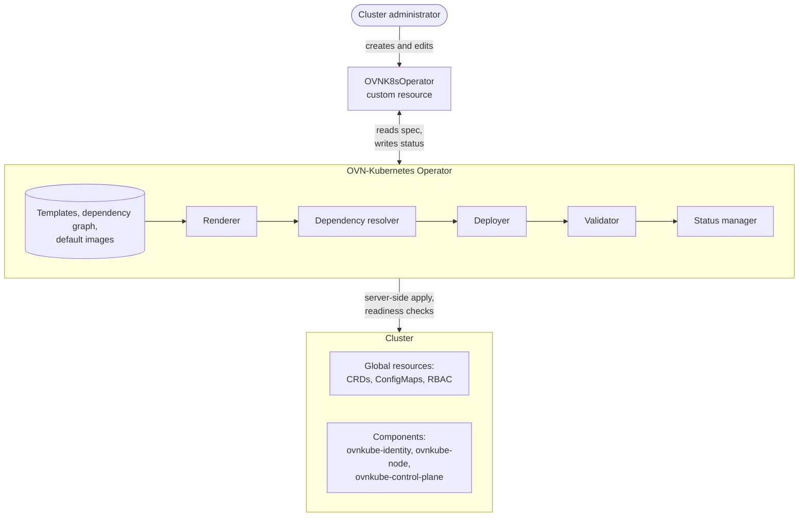
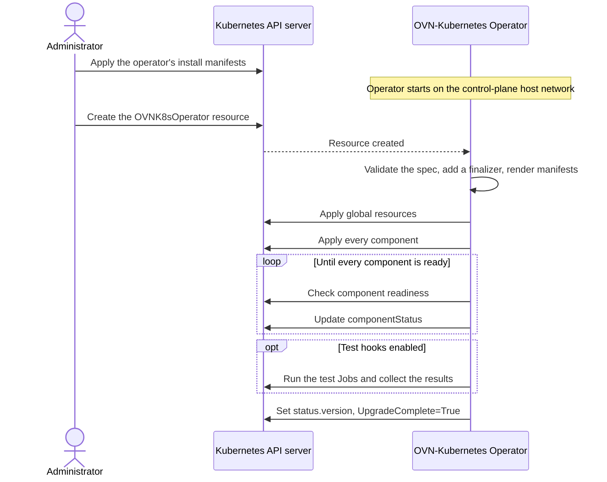
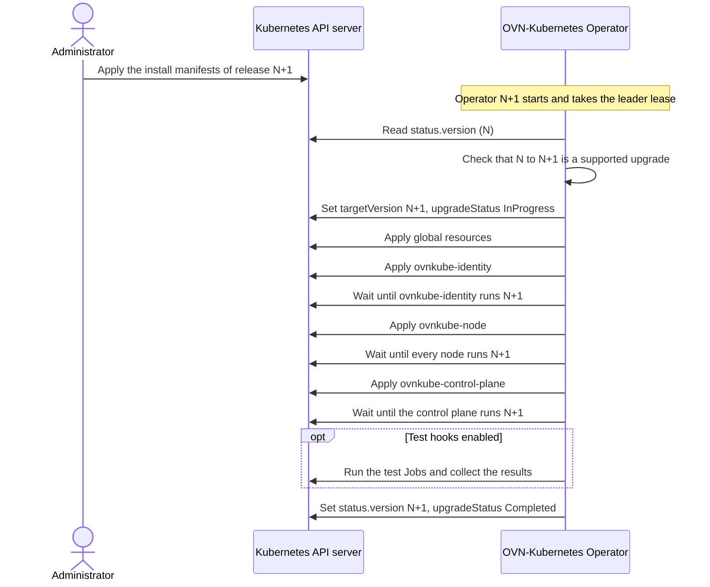
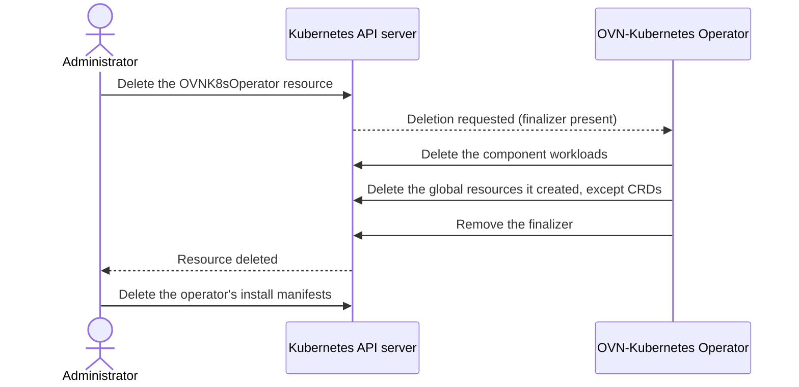

# OKEP-7136: OVN-Kubernetes Operator

- Issue: [#7136](https://github.com/ovn-kubernetes/ovn-kubernetes/issues/7136)

## Problem Statement

Today, OVN-Kubernetes is distributed as a Helm chart that includes a
sub-chart for each component: the control plane, the node, the identity
webhook, OVS, and IPsec. There is no Kubernetes operator for the project:
nothing owns the business logic for installing and upgrading OVN-Kubernetes,
and there is no single custom resource through which an administrator
describes the installation while the components underneath are managed for
them. As a result, every platform that runs OVN-Kubernetes has to write its
own operator, or its own scripts around the chart, instead of using a generic
solution from the project.

Upgrades carry the most risk, because every pod in the cluster relies on
OVN-Kubernetes for its network. The components depend on each other, and a
release can require one of them to be upgraded and ready before another
changes. Helm upgrades all sub-charts together. It has no notion of an order
between components, does not check that one is healthy before changing the
next, and gives no component-level view of an upgrade's progress or failure.

The project is also working toward CNCF incubation
([#5914](https://github.com/ovn-kubernetes/ovn-kubernetes/issues/5914)). The
incubation application includes a
[General Technical Review](https://github.com/cncf/toc/blob/main/operations/project-reviews/general-technical-questions.md),
whose installation and deployment questions ask how the project is installed,
how upgrades and rollbacks are planned and tested, and how the resources it
creates are cleaned up. Today, the answers depend on each platform's own
tooling rather than on the project.

This OKEP proposes the OVN-Kubernetes Operator, a generic operator shipped
with OVN-Kubernetes that owns the business logic for installation and
upgrades. It knows the components in a release and their dependencies,
deploys them in order, validates their health, and reports status. The
upgrade logic is abstracted from administrators: they need not worry about
the sub-components, and they get a single pane to manage installation and
upgrades through one custom resource.

## Terminology

- **Operator** - A Kubernetes controller that manages an application through a
custom resource, so the application can be handled as one object instead of
a collection of Deployments, DaemonSets, ConfigMaps, and RBAC.
- **Component** - A group of resources that the operator deploys and checks
together, such as the control plane Deployment (`ovnkubeControlPlane`), the
node DaemonSet (`ovnkubeNode`), or the identity webhook (`ovnkubeIdentity`),
each with its own RBAC and configuration.
- **Global resources** - Resources shared by all components, such as CRDs,
shared RBAC, and ConfigMaps. They are applied before any component.
- **Deployment mode** - The cluster topology: `standard`, `dpu-host`, or `dpu`.
The mode decides which components are deployed.
- **Dependency graph** - The directed acyclic graph, shipped with each
release, that says which components must be rolled out before others.

## Goals

- Provide a single custom resource through which administrators install,
configure, and upgrade OVN-Kubernetes, without managing its components
individually.
- Enable and configure OVN-Kubernetes features through feature gates in the
custom resource. The operator applies each feature gate consistently across
the component arguments, configuration, and RBAC it affects. Administrators
can also customize components, such as their images, placement, replicas,
and resources.
- During an upgrade, replace components in the order given by the dependency
graph, and validate each component's health before moving on to the
components that depend on it. A fresh installation or a configuration change
applies every component in one pass, since no older release is running.
- Upgrade OVN-Kubernetes by moving to a newer operator release. Each operator
release deploys one OVN-Kubernetes release, whose manifests and default
images are packaged in the operator image. The operator checks that the
requested upgrade is supported and blocks downgrades.
- Report the installed and target versions, per-component progress, and
failures in the custom resource's status.
- Support the `standard`, `dpu-host`, and `dpu` deployment modes with the same
machinery, with the mode deciding which components are deployed.
- Optionally run post-deployment tests that check the deployed network beyond
workload readiness.
- Make the operator the supported way to install and upgrade OVN-Kubernetes.
The Helm chart remains supported in the release that introduces the operator
and in the following release, and is deprecated in the release after that.

## Non-Goals

- The OVN-Kubernetes Operator does not support downgrading OVN-Kubernetes to
a previous version.
- Draining or rebooting nodes. These belong to the platform's node lifecycle;
the operator only replaces OVN-Kubernetes pods.
- Creating networking resources such as user-defined networks, route
advertisements, or network policies. The operator enables the features;
administrators create the objects that use them.

## Future Goals

- Pre-deployment hooks: Jobs supplied by the administrator that run before
any component is changed, for example to run preflight checks before an
upgrade.
- Metrics and alerts for rollout duration, retries, and failures.
- Managing the `ovn-ipsec` DaemonSet as a component, so that IPsec encryption
between nodes can be enabled through the custom resource.
- Managing the OVS DaemonSet as a component, including when OVS restarts on
each node during an upgrade.
- Repairing drift: watching the resources the operator manages and restoring
them when they are changed outside the operator, instead of only when the
custom resource changes (whether this should be supported is still to be
decided).
- A migration strategy for moving OVN-Kubernetes from Helm-managed to
operator-managed.

## Introduction

### What gets deployed

OVN-Kubernetes runs in [interconnect mode](../design/architecture.md), where
every node is its own OVN zone with its own databases. An installation
consists of four workloads in the `ovn-kubernetes` namespace:

- `ovnkube-control-plane`, a Deployment on the control-plane nodes, runs the
cluster manager. It allocates cluster-wide resources, such as each node's
pod subnet and transit switch address, and publishes them as annotations on
the nodes.
- `ovnkube-node`, a DaemonSet on every node, runs that node's OVN stack: the
northbound and southbound databases, `northd`, `ovn-controller`, and
`ovnkube-controller`, which translates Kubernetes objects into OVN and
serves the CNI.
- `ovnkube-identity`, a DaemonSet on the control-plane nodes, runs the
admission webhook that limits which annotations each node may write, and
approves the nodes' certificate requests.
- `ovs-node`, a DaemonSet on every node, runs Open vSwitch from the same
image. Clusters that run OVS directly on the host leave it out.

Clusters that encrypt traffic between nodes also run `ovn-ipsec`, a DaemonSet
with the IPsec daemons.

Around these workloads sit the resources they share: the namespace,
the configuration ConfigMaps, service accounts and RBAC, and the CRDs for
every OVN-Kubernetes API.

DPU-accelerated deployments use two clusters. The host cluster runs the
control plane and a host-side node component, `ovnkube-node-dpu-host`. A
second cluster, running on the DPUs, runs the OVN dataplane for each host in
`ovnkube-node-dpu`.

### How it is deployed today

The project ships an umbrella Helm chart, `helm/ovn-kubernetes`, with a
sub-chart for each workload and its DPU variants. Administrators enable
sub-charts through tags and describe the cluster's networks and features
through values. `contrib/kind.sh` uses the same chart to create development
and CI clusters.

A `helm install` or `helm upgrade` renders every enabled sub-chart and
applies the result in one step. Kubernetes then rolls out each Deployment and
DaemonSet on its own, following that workload's update strategy. Nothing makes
one component wait for another, and Helm reports success as soon as the
resources are applied or, with `--wait`, once all of them are ready.

### What an upgrade requires

OVN-Kubernetes is upgraded in place, while workload pods keep running. The
project's [upgrade design document](https://github.com/ovn-kubernetes/ovn-kubernetes/pull/6915)
describes what an upgrade must preserve:

- Upgrades move from one release to the next. Skipping a release or going
back to an older one is not supported.
- Components are replaced in a fixed order: `ovnkube-identity` first, then
`ovnkube-node` on every node, and `ovnkube-control-plane` last. The webhook
has to accept the annotations that new nodes write, and the cluster manager
may assume that every node already runs the new release.
- `ovnkube-node` is replaced node by node, so upgraded and non-upgraded nodes
run side by side, sometimes for hours or days.
- OVS must not restart underneath a running `ovnkube-node`, because that
tears down the bridge state it depends on.

This OKEP complements the upgrade design document: the document defines the
order and the guarantees an upgrade relies on, and the operator is what
enforces them on a cluster. Helm cannot do this on its own. It applies all
components together, so `ovnkube-identity` finishes its rollout in seconds,
but nothing holds the control plane back until every node has been upgraded.
The project's upgrade CI job shows how much has to happen around Helm: it
scales the control plane to zero before running `helm upgrade`, pins
`ovs-node` to the `OnDelete` update strategy so that OVS does not restart, and
waits for every rollout afterwards. An operator is needed to apply the order
on every cluster, waiting for each step to finish, as part of the release.

## User-Stories/Use-Cases

### Story 1: Install OVN-Kubernetes from one resource

As a cluster administrator, I want to install OVN-Kubernetes by creating one
custom resource that describes my cluster's networks, deployment mode, and
the features I need, so that I do not have to know which components to deploy
or in what order.

On a new cluster without a CNI, the administrator installs the operator and
creates the resource with the cluster's pod and service networks and the API
server address. The operator deploys the global resources and every
component, waits for them to become ready, and records the installed version
in the resource's status. On DPU-accelerated hardware, the administrator does
the same on the host cluster in `dpu-host` mode and on the DPU cluster in
`dpu` mode.

### Story 2: Upgrade by moving to a newer operator release

As a cluster administrator, I want to upgrade OVN-Kubernetes by deploying a
newer version of the operator, so that the operator upgrades the components
in the order defined by its upgrade business logic, without me planning each
step.

The operator checks that the cluster can move to the new release, then
replaces the components in that defined order, waiting for each one to become
ready before changing the components that depend on it. If a component does
not become ready, the upgrade stops there, and the resource's status shows
which component it is waiting on and why.

### Story 3: Change the configuration

As a cluster administrator, I want to enable features and adjust components
by editing the custom resource, and have the operator reconcile the
installation, so that every part of the installation a change affects is
updated together.

The operator reconciles each change across the installation. Enabling
user-defined networks, for example, turns the feature on in the control plane
and on every node, and adds the RBAC the cluster manager needs for it. The
same resource lets the administrator change a component's node placement,
replicas, or resources, or point it at a different image, for example to test
a development build on a Kind cluster.

## Proposed Solution

The proposal adds the OVN-Kubernetes Operator, a Kubernetes operator that
manages the installation and upgrades of the OVN-Kubernetes CNI.
Administrators describe the installation they want in a single
`OVNK8sOperator` custom resource, and the operator turns it into a running
installation. It renders the manifests for the selected deployment mode and
features, applies them, validates each component's health, and reports
progress in the resource's status; during an upgrade, it replaces the
components in dependency order. Each operator image carries what it needs for
one OVN-Kubernetes release: the resource templates, the component dependency
graph, and the default images. Upgrading OVN-Kubernetes therefore means
deploying a newer operator image.



### Design Principles

1. **The project owns the lifecycle; the administrator owns the
   configuration.** The custom resource holds what differs between clusters:
   networks, deployment mode, features, and component customization. Which
   components a release contains, how they depend on each other, and which
   images they run belong to the release, not to the API, so administrators
   cannot get them wrong.
2. **One operator release deploys one OVN-Kubernetes release.** The operator
   and OVN-Kubernetes share a version and are built from the same commit, and
   the default images are stamped into the operator image at build time. What
   an operator deploys is fixed when it is built and tested together with it.
3. **Its own rendering engine.** The operator renders manifests from Go
   templates packaged in its image, using a rendering engine that is part of
   the operator. It decides which components to render for the deployment
   mode and features, renders them, and applies the result itself. Because
   the project owns the engine, it can be extended for whatever customization
   OVN-Kubernetes needs, such as new template functions, new inputs from the
   custom resource, or new ways to patch the rendered resources.
4. **One reconcile path.** Installation, configuration changes, and upgrades
   all go through the same reconciliation: render the desired state from the
   custom resource and the release, apply what changed, validate the
   components, and report status. After a restart, the operator picks up from
   the resource's status and the live cluster.

### Workflow Description

An administrator works with two things: the operator's install manifests,
which run the operator itself, and the `OVNK8sOperator` resource, which
describes OVN-Kubernetes. Everything else is done by the operator.

#### Installation

The operator needs an API server address that is reachable without pod
networking to bootstrap the installation, since it installs the CNI itself.
The operator runs on the host network of a control-plane node. OVS must
already be running on every node.

The administrator applies the operator's install manifests, which create the
operator namespace, the default workload namespace (`ovn-kubernetes`), the
`OVNK8sOperator` CRD, the operator's RBAC, and its Deployment. They then
create the `OVNK8sOperator` resource for the cluster. On a fresh cluster
nothing older is running, so the operator applies the global resources and
every component in one pass and waits for all of them to become ready.



```sh
# Install the operator: namespaces, OVNK8sOperator CRD, RBAC, and Deployment
kubectl apply -f install.yaml
# Describe the cluster: networks, deployment mode, and features
kubectl apply -f ovnk8soperator.yaml
```

#### Upgrade

To upgrade, the administrator applies the install manifests of the newer
operator release, directly or through a GitOps tool. The new operator reads
the version recorded in the resource's status, checks that moving to its own
release is a supported upgrade, and records the target version before
changing anything. It then replaces the components in the order defined by
the release, waiting for each one to roll out at the new release before
changing the components that depend on it. If a component does not become
ready, the upgrade stops at that component and the status says why.



```sh
# Replace the operator with the newer release, which starts the upgrade
kubectl apply -f install.yaml
# Check progress: installed version, target version, and upgrade state
kubectl -n ovnk8s-operator-system get ovnk8soperator
```

```text
NAME      VERSION   TARGET   UPGRADE      AGE
default   1.4.0     1.5.0    InProgress   12d
```

#### Configuration changes

To change the configuration, for example to enable a feature or move a
component to other nodes, the administrator edits the `OVNK8sOperator`
resource. The operator reconciles the change: it renders the manifests again,
applies what changed, and deletes the resources that are no longer rendered,
such as the identity webhook's resources when the webhook is turned off.
Kubernetes rolls the affected workloads according to their update strategy.
Every component already runs the current release, so no upgrade ordering
applies.

```sh
# Change the configuration; the operator reconciles the change
kubectl -n ovnk8s-operator-system edit ovnk8soperator default
```

#### Uninstallation

Deleting the `OVNK8sOperator` resource removes OVN-Kubernetes from the
cluster. The finalizer keeps the resource until the operator has deleted the
component workloads and then the resources that supported them. The
OVN-Kubernetes CRDs are kept, so the networking objects that administrators
created, such as user-defined networks, are not lost. Removing the operator's
install manifests afterwards removes the operator itself.



```sh
# Remove OVN-Kubernetes; the operator deletes what it deployed, except CRDs
kubectl -n ovnk8s-operator-system delete ovnk8soperator default
# Remove the operator itself
kubectl delete -f install.yaml
```

### API Details

The operator adds one custom resource, `OVNK8sOperator`, in the
`k8s.ovn.org/v1alpha1` API group and version. It is a namespaced singleton:
the operator reconciles only the resource named `default` in its own
namespace, `ovnk8s-operator-system`, and the API server rejects any other
name. OVN-Kubernetes itself is deployed into the namespace named in the
resource, usually `ovn-kubernetes`, which must be different from the
operator's namespace.

The kind is named after the operator because the object configures the whole
installation the operator manages. It sits next to the other OVN-Kubernetes
APIs in `k8s.ovn.org`.

#### Example

This resource installs OVN-Kubernetes in standard mode with EgressIP and
AdminNetworkPolicy enabled:

```yaml
apiVersion: k8s.ovn.org/v1alpha1
kind: OVNK8sOperator
metadata:
  name: default
  namespace: ovnk8s-operator-system
spec:
  global:
    k8sAPIServer: https://192.168.10.10:6443
    deploymentMode: standard
    gatewayMode: shared
    namespace: ovn-kubernetes
    podNetwork:
      - cidr: 10.244.0.0/16
        hostPrefix: 24
    serviceNetwork:
      - 10.96.0.0/16
    mtu: 1400
  featureGates:
    egress:
      ip:
        healthCheckPort: 9107
    networkPolicy:
      admin: {}
```

#### Types

The types below show the shape of the API. The complete definition, with
every feature gate and validation rule, is generated into the API reference
under `docs/api-reference/` along with the implementation.

```go
// OVNK8sOperator is a namespaced singleton, named "default", that describes
// an OVN-Kubernetes installation.
type OVNK8sOperator struct {
	metav1.TypeMeta   `json:",inline"`
	metav1.ObjectMeta `json:"metadata,omitzero"`

	Spec   OVNK8sOperatorSpec   `json:"spec"`
	Status OVNK8sOperatorStatus `json:"status,omitzero"`
}

type OVNK8sOperatorSpec struct {
	// Cluster-wide networking and deployment settings.
	Global GlobalConfig `json:"global"`
	// OVN-Kubernetes features to enable, and their settings.
	FeatureGates *FeatureGates `json:"featureGates,omitempty"`
	// Per-component customization.
	ComponentOverrides []ComponentOverride `json:"componentOverrides,omitempty"`
	// Optional post-deployment tests.
	TestHooks *TestHooksSpec `json:"testHooks,omitempty"`
}

type GlobalConfig struct {
	K8sAPIServer   string            `json:"k8sAPIServer"`
	PodNetwork     []PodNetworkEntry `json:"podNetwork"`
	ServiceNetwork []string          `json:"serviceNetwork"`
	MTU            int32             `json:"mtu"`
	DeploymentMode string            `json:"deploymentMode"`
	GatewayMode    string            `json:"gatewayMode,omitempty"`
	Namespace      string            `json:"namespace"`

	ImagePullSecrets          []corev1.LocalObjectReference `json:"imagePullSecrets,omitempty"`
	PropagateImagePullSecrets *bool                         `json:"propagateImagePullSecrets,omitempty"`

	// dpu mode only: a Secret with the token and CA certificate for the host
	// cluster's API server.
	HostClusterCredentials *corev1.LocalObjectReference `json:"hostClusterCredentials,omitempty"`

	// ... optional subnet, metrics, and debugging fields
}

type ComponentOverride struct {
	// A component the deployment mode deploys, such as ovnkubeNode.
	ResourceName string `json:"resourceName"`
	// Turns an optional component on or off.
	Enabled *bool `json:"enabled,omitempty"`
	// Replica count, for Deployments.
	Replicas *int32 `json:"replicas,omitempty"`
	// Image repository, tag, and optional digest, replacing the default image.
	ContainerImages []ContainerImage `json:"containerImages,omitempty"`
	// Node selector, affinity, and tolerations.
	NodePlacement *NodePlacement `json:"nodePlacement,omitempty"`
	// Name-value pairs for settings that a component's templates support.
	CustomVariables []CustomVariable `json:"customVariables,omitempty"`
	// JSON (RFC 6902) or merge (RFC 7386) patches applied to the component's
	// workload after rendering.
	Patches []ComponentPatch `json:"patches,omitempty"`
}

type TestHooksSpec struct {
	Enabled bool `json:"enabled,omitempty"`
	// Tests to run; all of them when empty.
	Tests []string `json:"tests,omitempty"`
	// Timeout in seconds; 600 by default.
	Timeout int32 `json:"timeout,omitempty"`
}

type OVNK8sOperatorStatus struct {
	// Last release that was fully deployed, validated, and tested.
	Version string `json:"version,omitempty"`
	// Release the operator is rolling out.
	TargetVersion string `json:"targetVersion,omitempty"`
	// InProgress, Completed, or Failed.
	UpgradeStatus UpgradeStatus `json:"upgradeStatus,omitempty"`
	// UpgradeComplete, CNIHealthy, and ImagePullSecretsSynced.
	Conditions []metav1.Condition `json:"conditions,omitempty"`
	// For each component: phase, readiness, desired and ready replicas,
	// and the last error.
	ComponentStatus []ComponentStatus `json:"componentStatus,omitempty"`
}
```

#### Global settings

`spec.global` describes the cluster:

| Field                    | Description                                                                                                                                       |
| ------------------------ | ------------------------------------------------------------------------------------------------------------------------------------------------- |
| `k8sAPIServer`           | API server address the components use; reachable from every node without pod networking                                                           |
| `podNetwork`             | Pod network CIDRs, each with the prefix length allocated to every node; one entry per address family for dual-stack; cannot change after creation |
| `serviceNetwork`         | Service CIDRs, one per address family; cannot change after creation                                                                               |
| `mtu`                    | MTU of the pod network                                                                                                                            |
| `deploymentMode`         | `standard`, `dpu-host`, or `dpu`; cannot change after creation                                                                                    |
| `gatewayMode`            | `shared` (default) or `local`                                                                                                                     |
| `namespace`              | Namespace for the OVN-Kubernetes workloads; cannot change after creation                                                                          |
| `imagePullSecrets`       | Secrets for pulling images from a private registry, copied into the workload namespace unless `propagateImagePullSecrets` is `false`              |
| `hostClusterCredentials` | `dpu` mode only: a Secret in the operator's namespace with the token and CA certificate for the host cluster's API server                         |

Other optional fields set the join and masquerade subnets, the metrics
address, the first routing table ID for user-defined networks, and debugging
options such as core dumps.

#### Feature gates

Each feature is a typed field under `spec.featureGates`. Setting the field
enables the feature and leaving it out disables it; features without settings
take an empty object (`{}`). Related features are grouped under
`userDefinedNetworks`, `routing`, `egress`, and `networkPolicy`:

| Field                                        | Enables                                                            | Settings                                                                             |
| -------------------------------------------- | ------------------------------------------------------------------ | ------------------------------------------------------------------------------------ |
| `userDefinedNetworks`                        | User-defined networks                                              | `advertisedIsolationMode`: `strict` or `loose` isolation between advertised networks |
| `userDefinedNetworks.preconfiguredAddresses` | Preconfigured addresses for workloads on user-defined networks     |                                                                                      |
| `userDefinedNetworks.networkConnect`         | Cluster network connect between user-defined networks              |                                                                                      |
| `userDefinedNetworks.dynamicUDNAllocation`   | Rendering user-defined networks only on the nodes that need them   | `deletionGracePeriod`                                                                |
| `userDefinedNetworks.noOverlay`              | No-overlay mode for the default network                            | `snat`; `managedRouting` with `asNumber`, `topology`, and `frrNamespace`             |
| `routing.routeAdvertisements`                | BGP route advertisements                                           | `advertiseDefaultNetwork`                                                            |
| `routing.evpn`                               | EVPN                                                               |                                                                                      |
| `egress.ip`                                  | EgressIP                                                           | `healthCheckPort`                                                                    |
| `egress.firewall`                            | EgressFirewall                                                     |                                                                                      |
| `egress.qos`                                 | EgressQoS                                                          |                                                                                      |
| `egress.service`                             | EgressService                                                      |                                                                                      |
| `networkPolicy.admin`                        | AdminNetworkPolicy                                                 |                                                                                      |
| `networkPolicy.icmp`                         | ICMP and ICMPv6 traffic that bypasses network policy               |                                                                                      |
| `multicast`                                  | Multicast between pods                                             |                                                                                      |
| `hybridOverlay`                              | Hybrid overlay for mixed Linux and Windows clusters                |                                                                                      |
| `multiExternalGateway`                       | Multiple external gateways, through AdminPolicyBasedExternalRoute  |                                                                                      |
| `persistentIPs`                              | Persistent IP addresses for virtual machines                       |                                                                                      |
| `dnsNameResolver`                            | DNS names in EgressFirewall rules, through the DNSNameResolver CRD |                                                                                      |
| `networkQoS`                                 | NetworkQoS                                                         |                                                                                      |
| `uplink`                                     | The uplink feature for user-defined networks                       |                                                                                      |
| `serviceTemplateSupport`                     | OVN load balancer templates for Services                           |                                                                                      |
| `lflowCache`                                 | The logical flow cache in `ovn-controller`                         | `cacheLimit`, `cacheLimitKb`                                                         |
| `interconnect`                               | Nothing; interconnect is always on                                 | `v4TransitSwitchSubnet`, `v6TransitSwitchSubnet`                                     |

The operator turns each enabled feature into the arguments, configuration,
and RBAC of every component it affects.

Typed fields are more structured than the Helm chart's untyped values. The API
server validates them whenever the resource changes, related features are
grouped with their settings, and the API documents itself.

#### Component overrides

`spec.componentOverrides` customizes individual components, and each entry
names a component that the selected deployment mode deploys. Values set here
take precedence over the release's defaults. The identity webhook is on by
default in standard mode, and `enabled: false` turns it off; it is off by
default in `dpu-host` mode. Custom variables and patches are escape hatches:
they let administrators change what the typed fields do not cover, without
the validation that typed fields get. Overriding a component's image, through
`containerImages` or a patch, is meant for development and testing, such as
running a development build; a component running an image other than the
release's is outside the upgrade guarantees.

For example, this override runs the node component from a development image:

```yaml
spec:
  componentOverrides:
    - resourceName: ovnkubeNode
      containerImages:
        - name: default
          repository: ghcr.io/ovn-kubernetes/ovn-kubernetes/ovn-kube-ubuntu
          tag: master
```

#### Test hooks

`spec.testHooks` turns on post-deployment tests packaged with the release.
The operator runs each test as a Job. A rollout counts as complete only after
the selected tests pass; a failed test is reported in status, and the rollout
is not undone.

#### Status

`status.version` advances only after a rollout has been fully deployed,
validated, and tested, so during an upgrade it still names the previous
release while `targetVersion` names the new one. `upgradeStatus` gives the
state of the current rollout: `InProgress`, `Completed`, or `Failed`.
`kubectl get` shows all three as columns.

Three standard conditions describe the rollout and the installation's health.
Each condition's reason says why it holds its current value; on failure, it
names the stage that failed:

| Condition                | Status    | Reason                       | Meaning                                                                                       |
| ------------------------ | --------- | ---------------------------- | --------------------------------------------------------------------------------------------- |
| `UpgradeComplete`        | `True`    | `InstallationCompleted`      | The first installation completed                                                              |
| `UpgradeComplete`        | `True`    | `UpgradeCompleted`           | An upgrade to a new release completed                                                         |
| `UpgradeComplete`        | `True`    | `ReconciliationCompleted`    | A reconciliation of the installed release completed, for example after a configuration change |
| `UpgradeComplete`        | `False`   | `InstallationInProgress`     | The first installation is running                                                             |
| `UpgradeComplete`        | `False`   | `UpgradeInProgress`          | An upgrade to a new release is running                                                        |
| `UpgradeComplete`        | `False`   | `ReconciliationInProgress`   | The installed release is being reconciled, for example after a configuration change           |
| `UpgradeComplete`        | `False`   | `VersionValidationFailed`    | The new release is not a supported upgrade from the installed one                             |
| `UpgradeComplete`        | `False`   | `DependencyResolutionFailed` | The release's dependency graph could not be resolved                                          |
| `UpgradeComplete`        | `False`   | `TemplateRenderingFailed`    | The manifests could not be rendered from the templates and the custom resource                |
| `UpgradeComplete`        | `False`   | `ComponentDeploymentFailed`  | Applying a component's resources failed                                                       |
| `UpgradeComplete`        | `False`   | `ComponentValidationFailed`  | A component did not become ready in time                                                      |
| `UpgradeComplete`        | `False`   | `TestHooksFailed`            | A post-deployment test failed                                                                 |
| `CNIHealthy`             | `True`    | `Ready`                      | Every component was ready when the last rollout or reconciliation completed                   |
| `CNIHealthy`             | `False`   | `Degraded`                   | One or more components failed, so the CNI is only partly working                              |
| `CNIHealthy`             | `Unknown` | `Initializing`               | The first installation is still running                                                       |
| `CNIHealthy`             | `Unknown` | `Unknown`                    | The resource is being deleted and the operator is removing the installation                   |
| `ImagePullSecretsSynced` | `True`    | `Synced`                     | Every referenced image pull secret was copied into the workload namespace                     |
| `ImagePullSecretsSynced` | `True`    | `SkippedByUser`              | Copying is turned off with `propagateImagePullSecrets: false`                                 |
| `ImagePullSecretsSynced` | `False`   | `SyncFailed`                 | The image pull secrets could not be copied                                                    |

`CNIHealthy` changes only when a rollout or reconciliation completes or
fails, so during an upgrade it still describes the previous release. It does
not monitor the datapath continuously.

`componentStatus` lists each component with its phase (`Deploying`, `Ready`,
`Failed`, or `Unknown`), whether it is ready, its desired and ready replicas,
and a message or the last error.

A resource in the middle of an upgrade might report:

```yaml
status:
  version: "1.4.0"
  targetVersion: "1.5.0"
  upgradeStatus: InProgress
  conditions:
    - type: UpgradeComplete
      status: "False"
      reason: UpgradeInProgress
    - type: CNIHealthy
      status: "True"
      reason: Ready
  componentStatus:
    - resourceName: ovnkubeIdentity
      resourceType: DaemonSet
      phase: Ready
      ready: true
      replicas: 3
      readyReplicas: 3
    - resourceName: ovnkubeNode
      resourceType: DaemonSet
      phase: Deploying
      ready: false
      replicas: 10
      readyReplicas: 6
      message: "Ready: 6/10, Available: 6/10, Updated: 6/10"
```

### Implementation Details

#### Code layout

The operator is a separate Go module in the top-level `operator/` directory,
scaffolded with Kubebuilder and built on controller-runtime.

| Package               | Responsibility                                         |
| --------------------- | ------------------------------------------------------ |
| `internal/controller` | Reconciles the `OVNK8sOperator` resource               |
| `internal/defaults`   | Loads the release configuration embedded in the binary |
| `internal/renderer`   | Renders the templates into manifests                   |
| `internal/dependency` | Resolves the component dependency graph                |
| `internal/deployer`   | Orders, labels, applies, and cleans up resources       |
| `internal/validator`  | Checks workload readiness                              |
| `internal/status`     | Writes status and conditions                           |
| `internal/testhook`   | Runs post-deployment tests                             |

The templates in `operator/templates/` and the test hooks in
`operator/test-hooks/` are copied into the operator image.

#### Release configuration

Each operator release embeds a configuration file with everything that
belongs to the release rather than to the API:

- the OVN-Kubernetes version, and the oldest version that can upgrade to it;
- the components of each deployment mode, and which of them are optional;
- for each component, its workload kind, its default images, the components
it depends on, and which containers use which image.

#### Reconciliation

The controller watches the `OVNK8sOperator` resource and reconciles when its
spec changes or the operator starts. Leader election keeps a single active
instance. Each reconciliation:

1. adds the finalizer, checks the version transition, and records the target
   version;
2. renders the manifests and resolves the dependency graph;
3. applies the global resources, then the components, and deletes the
   resources that are no longer rendered;
4. waits for the components to become ready and runs the enabled test hooks;
5. records the outcome in status.

Every step is idempotent, so a restarted operator picks up from the
resource's status and the live cluster. Changes made to managed resources
outside the operator are reverted on the next reconciliation, not when they
happen.

#### Rendering

Templates are Go `text/template` files grouped by component: `global/` holds
the resources all components share, and each component has a directory with
its own name, such as `ovnkubeNode/`. Every template receives the custom
resource and the release configuration. Component overrides are template
inputs too, except patches, which are applied to the rendered workload last.

#### Component dependencies and rollout gates

Each component lists the components it depends on. The operator builds a
directed acyclic graph from these lists, rejects cycles, and drops edges to
components that are turned off. The current release follows the order in the
upgrade design document: the identity webhook first, then the nodes, and the
control plane last.

Two kinds of ordering apply:

- **Resource order.** Resources are applied in a predefined, static order by
kind. Global resources, including the CRDs, come first on every pass, and
within a component, service accounts and ConfigMaps exist before the RBAC,
Services, and workloads that use them.
- **Rollout gates.** The graph's edges are enforced only while some component
still runs an older release. The deployer stamps each workload with the
release it was rendered from, and a component is applied only after its
dependencies run the target release with every pod updated and available.
Ready pods from the old revision do not count.

The fixed order matters only while two releases run side by side. A fresh
installation has no older release, and a configuration change keeps the same
release, so in both cases every component is applied in one pass.

#### Applying resources

The deployer applies each rendered resource with server-side apply, as field
manager `ovnk8s-operator`, and takes ownership of the fields it renders.
When the operator stops rendering a field it managed, it gives up ownership
of the field, and Kubernetes removes it from the live object or restores its
default. A resource that already exists under the same name is
adopted and managed like the rest.

Every resource carries three labels: `app.kubernetes.io/managed-by`,
`ovnk8s-operator.ovn.org/ovnk8soperator` with the custom resource's name, and
`ovnk8s-operator.ovn.org/component`. The operator tracks what it created
through these labels, instead of relying on owner references. After applying
the desired state, it deletes the labeled resources that are no longer
rendered, for example the identity webhook's DaemonSet and webhook
configurations after the webhook is turned off. CRDs are never deleted; see
[Cleanup](#cleanup). The operator also generates the identity webhook's serving
certificate and keeps it in a Secret, so no external certificate tooling is
needed.

#### Version checks

Before changing anything, the operator compares its release with
`status.version`, the last release fully deployed, and with
`status.targetVersion`, the release being rolled out. It continues with a
fresh installation, the same release, or a supported upgrade. It rejects a
release older than either version, or an upgrade from a release older than
the oldest one the release supports, with `VersionValidationFailed`.

The target version is recorded before any component changes, so an
interrupted upgrade resumes toward the same target after a restart. Checking
it also enforces the upgrade design document's rule that a cluster counts as
being on a release once any of its components has run. If an upgrade to N+1
stops partway and the operator is reverted to N, `status.version` still says
N, but `status.targetVersion` says N+1, so N is rejected. A stopped upgrade is
recovered by moving forward instead: the administrator fixes the cause, or
deploys a patch release of N+1 that contains the fix, and the operator, which
keeps retrying, completes the upgrade.

#### Deployment modes

The deployment mode selects the release's component list; everything else in
this section applies to all three modes.

| Mode       | Cluster                           | Components                                                                    |
| ---------- | --------------------------------- | ----------------------------------------------------------------------------- |
| `standard` | A cluster without DPUs            | `ovnkubeControlPlane`, `ovnkubeNode`, and `ovnkubeIdentity`                   |
| `dpu-host` | The cluster whose nodes have DPUs | `ovnkubeControlPlane`, `ovnkubeNodeDpuHost`, and optionally `ovnkubeIdentity` |
| `dpu`      | The cluster running on the DPUs   | `ovnkubeNodeDpu`                                                              |

The DPU-side node component acts on behalf of its host, so a `dpu`
installation describes the host cluster: `k8sAPIServer`, `podNetwork`, and
`serviceNetwork` are the host cluster's, and `hostClusterCredentials` refers
to a Secret with the credentials for the host's API server rather than
embedding them. Each cluster runs its own operator and is upgraded
separately.

#### Running test hooks

A test hook is a set of resources, typically a Job and its RBAC, kept in
`test-hooks/` in the operator image and rendered with the same data as the
components. After every component is ready, the operator applies the selected
hooks, waits for each Job to finish within the timeout, reports the result in
status, and deletes the test resources.

#### Cleanup

The finalizer keeps the custom resource until cleanup finishes. The operator
deletes every resource that carries its labels, except CRDs, going through
the resource kinds in reverse order, so workloads are removed before the
RBAC and ConfigMaps they use. If cleanup fails, the finalizer stays and the
operator retries.

The CRDs are kept because deleting a CRD deletes every object of that type,
such as the user-defined networks and EgressIPs that administrators created.
The Helm chart behaves the same way: it installs its CRDs from `crds/`, which
`helm uninstall` leaves in place. The workload namespace belongs to the
operator's install manifests and is removed with them.

### Testing Details

- **Unit tests** cover dependency graph resolution, rendering of every feature
gate and component override, resource ordering, version checks, status
updates, removal of resources that are no longer rendered, and cleanup.
Template tests check that each input from the custom resource reaches the
right field of the rendered manifests, and that the operator's own RBAC
covers every resource it renders.
- **API tests** check the CRD's validation rules against a real API server,
in `test/crd-integration/`.
- **Helm parity:** while the Helm chart is supported, a CI job renders the
chart and the operator's templates for the same configuration and compares
the results, so the two do not drift apart.
- **E2E tests:** a Kind lane installs OVN-Kubernetes through the operator,
checks pod-to-pod, Service, and DNS traffic across nodes, then deletes the
custom resource and checks that everything the operator created is gone
except the CRDs and the objects of those types. The existing E2E suites run
against operator-installed clusters as well.
- **Upgrade tests:** an upgrade lane installs the previous release through
the operator and upgrades by moving to the operator under test, then runs
the E2E suites. It also checks the order: the control plane does not change
until every node runs the new release. Further cases cover a component that
never becomes ready, an operator restart during an upgrade, and a rejected
downgrade, including an operator reverted partway through an upgrade.
- **DPU modes:** `dpu-host` and `dpu` installations run on the Kind DPU
simulation already used by the project's CI.
- **Cross-feature tests:** IPv4, IPv6, and dual-stack clusters; local and
shared gateway modes; the identity webhook on and off.
- **Scale tests:** reconciliation time and API load as the number of nodes
grows, and long rollouts across many nodes staying within the readiness
timeouts.

### Documentation Details

- **Installation:** a guide in `docs/installation/` for installing
OVN-Kubernetes through the operator, on Kind and on an existing cluster.
- **API reference:** the `OVNK8sOperator` reference, generated from the CRD
into `docs/api-reference/`.
- **Operations:** how to upgrade, how to read the resource's status, and what
to do when an upgrade stops at a component.
- **Developer guide:** how to add a component or a feature gate.

## Risks, Known Limitations and Mitigations

- **Two sets of manifests.** While the Helm chart is supported, every
manifest change has to be made in both the chart and the operator's
templates. The Helm parity job catches drift between them, and chart
changes are infrequent compared with code changes, so the extra work stays
small.
- **Stalled upgrades need intervention.** An upgrade stops at the first
component that does not become ready and stays there. The operator does not
roll back or heal the installation on its own; an administrator fixes the
cause, using the component and reason that status reports, or moves to a
patch release that contains the fix, and the upgrade then continues.

## OVN-Kubernetes Version Skew

To be discussed. Each operator release deploys the OVN-Kubernetes release with
the same version, so the operator follows the project's upgrade policy:
upgrades move from one release to the next, in the order the upgrade design
document defines.

## Backwards Compatibility

The operator is a new, opt-in way to install OVN-Kubernetes. It adds one CRD,
`OVNK8sOperator` at `v1alpha1`, and does not change any existing API,
component, or datapath behavior. It deploys the same workloads with the same
configuration as the Helm chart, so a cluster behaves the same whichever way
it was installed.

The Helm chart and the operator coexist for a limited time: the chart
remains supported in the release that introduces the operator and in the
following release, and is deprecated in the release after that. Existing E2E
tests are unchanged: the operator adds its own test lanes and runs the
existing suites against operator-installed clusters.

## Alternatives Considered

- **Render the Helm chart inside the operator.** The operator could render
the existing chart with the Helm Go library, mapping the custom resource to
the chart's values, and avoid a second set of manifests. The tradeoff is
coupling: inputs that the chart's values do not cover would need either new
values, which are a public interface for Helm users, or patches applied after
rendering, which are harder to review and test. Keeping its own templates
costs a second set of manifests, but lets the operator's API and manifests
change together.
- **Build resources in Go code.** The operator could construct every
Deployment, DaemonSet, and RBAC object in Go, as KubeVirt's virt-operator
does, so that the compiler checks the structure of each resource. YAML
templates are easier for this project to work with and maintain. They are
the format OVN-Kubernetes manifests already use, and they were converted
from the Helm chart, so a change can be carried between the two while both
are supported. A manifest change stays a YAML diff that anyone who knows
Kubernetes can review, and adding a resource or a component means adding a
template file rather than changing operator code. The rendered output can
also be compared with the Helm chart directly, and tests and the API server
still catch malformed resources.
- **Keep the operator or its templates outside this repository.** The
operator could live in a repository of its own, or load its templates at
runtime from a ConfigMap, a Git repository, or an OCI artifact. Either way,
manifests would change on a different schedule from the code, and an operator
could deploy manifests that were never tested with the components they run.
Keeping the operator and its templates in this repository means a component
change, its manifests, and its upgrade constraints are reviewed and released
together, under one version.
- **Put versions and dependencies in the custom resource.** The API could let
administrators choose each component's version and declare which components
depend on which. That is flexible, but it makes administrators responsible
for release internals they should not need to know, and a wrong version or
dependency graph can break an upgrade. Versions and dependencies belong to
the release, so they are part of the operator's embedded configuration.
- **Make the custom resource cluster-scoped.** This design keeps the
resource namespaced, in the operator's namespace, next to the operator's
Deployment and the Secrets the resource refers to, such as image pull
secrets. Administrators, or a GitOps tool limited to that namespace, can
then manage the configuration without permission to create cluster-scoped
objects. KubeVirt and Istio's in-cluster operator also use namespaced
resources; the Tigera operator and CNO use cluster-scoped singletons.

## Comparison with Other Operators

- **Tigera operator.** The closest precedent: a CNI installed and upgraded by
an operator from a singleton installation resource, with progress reported
in `TigeraStatus` resources. Its `Installation` resource is cluster-scoped,
with typed fields for each component and an `ImageSet` that pins image
digests, and the operator builds its resources in Go code. It can also take
over a Calico installation made from manifests: it detects the existing
resources, keeps the configuration it supports, and warns about the rest.
- **OpenShift Cluster Network Operator.** CNO is configured through the
cluster-scoped `Network` resource named `cluster`. Like this design, it
renders YAML templates with Go `text/template` and applies them with
server-side apply. It also already orders OVN-Kubernetes upgrades: it
pre-pulls the new image on every node, rolls out `ovnkube-node`, and updates
the control plane only after every node has finished, the order this design
follows. But it is part of OpenShift. It manages the cluster's networking as
a whole, including Multus and other components, works through OpenShift's
configuration APIs, and follows OpenShift's releases rather than the
project's, so it is not an option on other distributions. In OpenShift, node
drains and reboots belong to the Machine Config Operator, and network changes
that need them, such as a migration to OVN-Kubernetes or an MTU change, go
through it. This operator only replaces pods, so such changes depend on the
platform.
- **KubeVirt virt-operator.** Like this design, it is configured through a
namespaced resource, couples the deployed release to the operator version by
default, lets administrators patch the rendered components through
`customizeComponents`, and reports the observed and target versions in
status. Unlike this design, it builds its resources in Go code. It upgrades
its node DaemonSet through a single canary pod before the rest of the nodes.
- **Istio in-cluster operator.** It rendered Istio's Helm charts, customized
through Helm values and Kubernetes overlays in the `IstioOperator` resource.
It applied its components along a fixed dependency tree and waited for each
to become ready, much like this design. Istio deprecated it in 1.23 and
removed it in 1.24, citing the confusion of offering three installation
methods. Istio's recommended upgrades also differ: revision-based canary
upgrades run the old and new control planes side by side and move workloads
gradually, while this operator upgrades in place and only moves forward.

## References

- [Upgrade design document (PR #6915)](https://github.com/ovn-kubernetes/ovn-kubernetes/pull/6915):
the upgrade order and guarantees that the operator follows.
- [CNCF General Technical Review questions](https://github.com/cncf/toc/blob/main/operations/project-reviews/general-technical-questions.md):
the installation, upgrade, and rollback questions in the incubation
application.
- [Launching OVN-Kubernetes with Helm](../installation/launching-ovn-kubernetes-with-helm.md):
the Helm chart that the operator's templates were converted from.
- [Tigera operator](https://github.com/tigera/operator) and its
[Installation API](https://docs.tigera.io/calico/latest/reference/installation/api).
- [OpenShift Cluster Network Operator](https://github.com/openshift/cluster-network-operator).
- [KubeVirt virt-operator](https://github.com/kubevirt/kubevirt/tree/main/pkg/virt-operator)
and [customizing its components](https://kubevirt.io/user-guide/cluster_admin/customize_components/).
- [Istio has deprecated its In-Cluster Operator](https://istio.io/latest/blog/2024/in-cluster-operator-deprecation-announcement/):
Istio's reasons for deprecating its operator.
